# Jarkom-Modul-5-2026-K-42

## Anggota

| | Nama | NRP |
| --- | --- | --- |
| 1 | Azita Zahwa Zahida Asmoro | 5027251058 |
| 2 | I Made Gyanendra Anand Wisnawa | 5027251072 |

# Soal 1

## Topologi

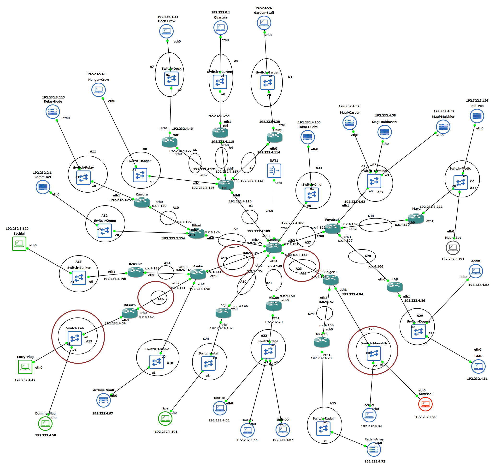

## Tabel VLSM

Berikut merupakan tabel perhitungannya:
[Tabel Perhitungan VLSM](https://docs.google.com/spreadsheets/d/10po2tn_7QFhXGicL6j-1PMKqqFpVFeZxA0GC1t46BZs/edit?usp=sharing)

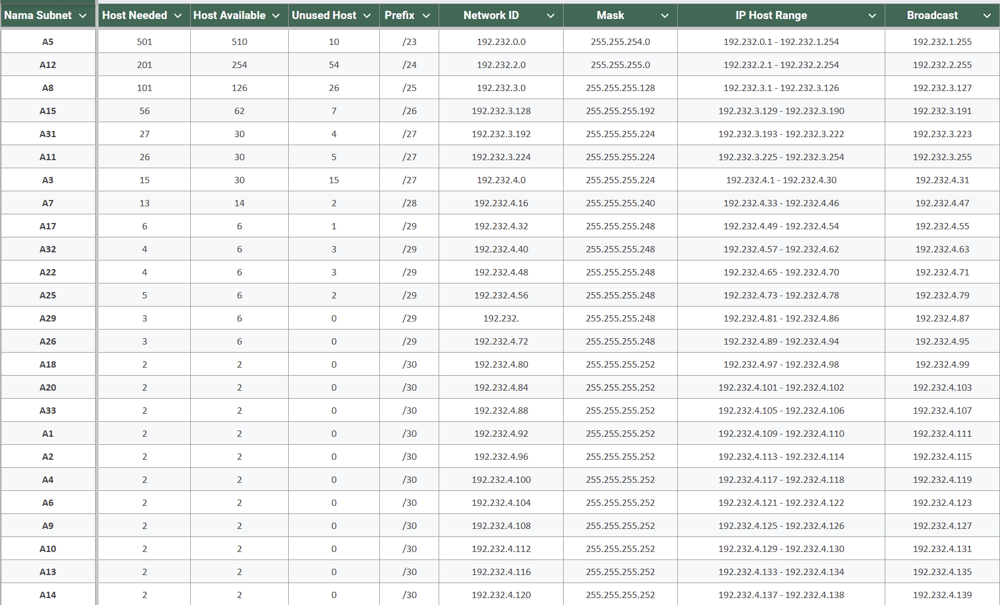
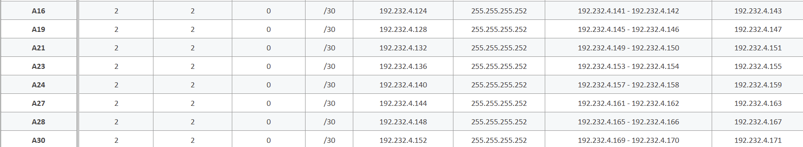

# Soal 2

## Konfigurasi per Router

### Gendou

```bash
auto lo
iface lo inet loopback

# Interface ke NAT1 (DHCP + aktifkan IP forwarding)
auto eth0
iface eth0 inet dhcp
    up ip link set dev eth0 up
    up sysctl -w net.ipv4.ip_forward=1

# Link A33 ke Switch-Cmd / Tokyo3-Core
auto eth1
iface eth1 inet static
    address 192.232.4.106
    netmask 255.255.255.252
    up ip link set dev eth1 up

# Link A27 ke Router Fuyutsuki
auto eth2
iface eth2 inet static
    address 192.232.4.161
    netmask 255.255.255.252
    up ip link set dev eth2 up
    
# Link A23 ke Router Shigeru
auto eth3
iface eth3 inet static
    address 192.232.4.153
    netmask 255.255.255.252
    up ip link set dev eth3 up
    
# Link A21 ke Router Misato
auto eth4
iface eth4 inet static
    address 192.232.4.149
    netmask 255.255.255.252
    up ip link set dev eth4 up
    
# Link A19 ke Router Kaji
auto eth5
iface eth5 inet static
    address 192.232.4.145
    netmask 255.255.255.252
    up ip link set dev eth5 up
    
# Link A13 ke Router Asuka
auto eth6
iface eth6 inet static
    address 192.232.4.134
    netmask 255.255.255.252
    up ip link set dev eth6 up
    
# Link A9 ke Router Hikari
auto eth7
iface eth7 inet static
    address 192.232.4.125
    netmask 255.255.255.252
    up ip link set dev eth7 up
    
# Link A1 ke Router Yui
auto eth8
iface eth8 inet static
    address 192.232.4.109
    netmask 255.255.255.252
    up ip link set dev eth8 up
```

### Yui

```bash
auto lo
iface lo inet loopback

auto eth0
iface eth0 inet static
    address 192.232.4.110
    netmask 255.255.255.252
    gateway 192.232.4.109
    up ip link set dev eth0 up
    up sysctl -w net.ipv4.ip_forward=1

# LAN A8 (Switch-Hangar / Hangar-Crew)
auto eth1
iface eth1 inet static
    address 192.232.3.126
    netmask 255.255.255.128
    up ip link set dev eth1 up

# Link A6 ke Mari
auto eth2
iface eth2 inet static
    address 192.232.4.121
    netmask 255.255.255.252
    up ip link set dev eth2 up
    up ip route add 192.232.4.32/28 via 192.232.4.122

# Link A4 ke Rei
auto eth3
iface eth3 inet static
    address 192.232.4.117
    netmask 255.255.255.252
    up ip link set dev eth3 up
    up ip route add 192.232.0.0/23 via 192.232.4.118

# Link A2 ke Shinji
auto eth4
iface eth4 inet static
    address 192.232.4.113
    netmask 255.255.255.252
    up ip link set dev eth4 up
    up ip route add 192.232.4.0/27 via 192.232.4.114
```

### Rei

```bash
auto lo
iface lo inet loopback

auto eth0
iface eth0 inet static
    address 192.232.4.118
    netmask 255.255.255.252
    gateway 192.232.4.117
    up ip link set dev eth0 up
    up sysctl -w net.ipv4.ip_forward=1

# LAN A5 (Switch-Quarters / Quarters)
auto eth1
iface eth1 inet static
    address 192.232.1.254
    netmask 255.255.254.0
    up ip link set dev eth1 up
```

### Shinji

```bash
auto lo
iface lo inet loopback

auto eth0
iface eth0 inet static
    address 192.232.4.114
    netmask 255.255.255.252
    gateway 192.232.4.113
    up ip link set dev eth0 up
    up sysctl -w net.ipv4.ip_forward=1

# LAN A3 (Switch-Garden / Garden-Staff)
auto eth1
iface eth1 inet static
    address 192.232.4.30
    netmask 255.255.255.224
    up ip link set dev eth1 up
```

### Mari

```bash
auto lo
iface lo inet loopback

auto eth0
iface eth0 inet static
    address 192.232.4.122
    netmask 255.255.255.252
    gateway 192.232.4.121
    up ip link set dev eth0 up
    up sysctl -w net.ipv4.ip_forward=1

# LAN A7 (Switch-Dock / Dock-Crew)
auto eth1
iface eth1 inet static
    address 192.232.4.46
    netmask 255.255.255.240
    up ip link set dev eth1 up
```

### Hikari

```bash
auto lo
iface lo inet loopback

auto eth0
iface eth0 inet static
    address 192.232.4.126
    netmask 255.255.255.252
    gateway 192.232.4.125
    up ip link set dev eth0 up
    up sysctl -w net.ipv4.ip_forward=1

# LAN A12 (Switch-Comm / Comm-Net)
auto eth1
iface eth1 inet static
    address 192.232.2.254
    netmask 255.255.255.0
    up ip link set dev eth1 up

# Link A10 ke Kaworu
auto eth2
iface eth2 inet static
    address 192.232.4.129
    netmask 255.255.255.252
    up ip link set dev eth2 up
```

### Kaworu

```bash
auto lo
iface lo inet loopback

auto eth0
iface eth0 inet static
    address 192.232.4.130
    netmask 255.255.255.252
    gateway 192.232.4.129
    up ip link set dev eth0 up
    up sysctl -w net.ipv4.ip_forward=1

# LAN A11 (Switch-Hangar / Hangar-Crew)
auto eth1
iface eth1 inet static
    address 192.232.3.254
    netmask 255.255.255.224
    up ip link set dev eth1 up
```

### Asuka

```bash
auto lo
iface lo inet loopback

auto eth0
iface eth0 inet static
    address 192.232.4.133
    netmask 255.255.255.252
    gateway 192.232.4.134
    up ip link set dev eth0 up
    up sysctl -w net.ipv4.ip_forward=1

# Link A14 ke Kensuke
auto eth1
iface eth1 inet static
    address 192.232.4.98
    netmask 255.255.255.252
    up ip link set dev eth1 up
    
# Link A16 ke Ritsuko
auto eth2
iface eth2 inet static
    address 192.232.4.141
    netmask 255.255.255.252
    up ip link set dev eth2 up
    
# Link A18 ke Archive-Vault
auto eth3
iface eth3 inet static
    address 192.232.4.137
    netmask 255.255.255.252
    up ip link set dev eth3 up
```

### Kensuke

```bash
auto lo
iface lo inet loopback

auto eth0
iface eth0 inet static
    address 192.232.4.138
    netmask 255.255.255.252
    gateway 192.232.4.137
    up ip link set dev eth0 up
    up sysctl -w net.ipv4.ip_forward=1

# LAN A15 (Switch-Bunker / Sachiel)
auto eth1
iface eth1 inet static
    address 192.232.3.190
    netmask 255.255.255.192
    up ip link set dev eth1 up
```

### Ritsuko

```bash
auto lo
iface lo inet loopback

auto eth0
iface eth0 inet static
    address 192.232.4.142
    netmask 255.255.255.252
    gateway 192.232.4.141
    up ip link set dev eth0 up
    up sysctl -w net.ipv4.ip_forward=1

# LAN A17 (Switch-Lab / Entry-Plug)
auto eth1
iface eth1 inet static
    address 192.232.4.54
    netmask 255.255.255.248
    up ip link set dev eth1 up
```

### Kaji

```bash
auto lo
iface lo inet loopback

auto eth0
iface eth0 inet static
    address 192.232.4.146
    netmask 255.255.255.252
    gateway 192.232.4.145
    up ip link set dev eth0 up
    up sysctl -w net.ipv4.ip_forward=1

# Link A20 ke Spy
auto eth1
iface eth1 inet static
    address 192.232.4.102
    netmask 255.255.255.252
    up ip link set dev eth1 up
```

### Misato

```bash
auto lo
iface lo inet loopback

auto eth0
iface eth0 inet static
    address 192.232.4.150
    netmask 255.255.255.252
    gateway 192.232.4.149
    up ip link set dev eth0 up
    up sysctl -w net.ipv4.ip_forward=1

# LAN A22 (Switch-Cage / Unit-01, Unit-02, Unit-00)
auto eth1
iface eth1 inet static
    address 192.232.4.70
    netmask 255.255.255.248
    up ip link set dev eth1 up
```

### Shigeru

```bash
auto lo
iface lo inet loopback

auto eth0
iface eth0 inet static
    address 192.232.4.154
    netmask 255.255.255.252
    gateway 192.232.4.153
    up ip link set dev eth0 up
    up sysctl -w net.ipv4.ip_forward=1

# LAN A26 (Switch-Monolith / Zeruel & Armisael)
auto eth1
iface eth1 inet static
    address 192.232.4.94
    netmask 255.255.255.248
    up ip link set dev eth1 up

# Link A24 ke Makoto
auto eth2
iface eth2 inet static
    address 192.232.4.157
    netmask 255.255.255.252
    up ip link set dev eth2 up
```

### Makoto

```bash
auto lo
iface lo inet loopback

auto eth0
iface eth0 inet static
    address 192.232.4.158
    netmask 255.255.255.252
    gateway 192.232.4.157
    up ip link set dev eth0 up
    up sysctl -w net.ipv4.ip_forward=1

# LAN A25 (Switch-Radar / Radar-Array)
auto eth1
iface eth1 inet static
    address 192.232.4.78
    netmask 255.255.255.248
    up ip link set dev eth1 up
```

### Toji

```bash
auto lo
iface lo inet loopback

auto eth0
iface eth0 inet static
    address 192.232.4.166
    netmask 255.255.255.252
    gateway 192.232.4.165
    up ip link set dev eth0 up
    up sysctl -w net.ipv4.ip_forward=1

# LAN A29 (Switch-Dogma / Lilith)
auto eth1
iface eth1 inet static
    address 192.232.4.86
    netmask 255.255.255.248
    up ip link set dev eth1 up
```

### Fuyutsuki

```bash
auto lo
iface lo inet loopback

# Link A27 ke Gendou
auto eth0
iface eth0 inet static
    address 192.232.4.162
    netmask 255.255.255.252
    gateway 192.232.4.161
    up ip link set dev eth0 up
    up sysctl -w net.ipv4.ip_forward=1

# LAN A32 (Switch-Terminal / Magi)
auto eth1
iface eth1 inet static
    address 192.232.4.62
    netmask 255.255.255.248
    up ip link set dev eth1 up

# Link A28 ke Toji
auto eth2
iface eth2 inet static
    address 192.232.4.169
    netmask 255.255.255.252
    up ip link set dev eth2 up

# Link A30 ke Maya
auto eth3
iface eth3 inet static
    address 192.232.4.165
    netmask 255.255.255.252
    up ip link set dev eth3 up
```

### Maya

```bash
auto lo
iface lo inet loopback

auto eth0
iface eth0 inet static
    address 192.232.4.170
    netmask 255.255.255.252
    gateway 192.232.4.169
    up ip link set dev eth0 up
    up sysctl -w net.ipv4.ip_forward=1

# LAN A31 (Switch-Medic / Pen-Pen)
auto eth1
iface eth1 inet static
    address 192.232.3.222
    netmask 255.255.255.224
    up ip link set dev eth1 up
```

## Verifikasi Koneksi

Jalankan perintah `ip -br a` di setiap router.

```bash
ip -br a
```


Kemudian jalankan ping ke router lain dengan menggunakan `ping <IP_ADDRESS>`.

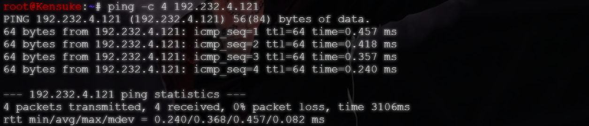

# Soal 3

## Konfigurasi per Router

Pada soal nomor 3, lengkapi konfigurasi di setiap router. Lihat pada bagian masing-masing konfigurasi, akan ada `up ip route add ....`. Inilah yang harus ditambahkan di soal nomor 3.

### Gendou

```bash
auto lo
iface lo inet loopback

# Interface ke NAT1 (DHCP + aktifkan IP forwarding)
auto eth0
iface eth0 inet dhcp
    up ip link set dev eth0 up
    up sysctl -w net.ipv4.ip_forward=1

# Link A33 ke Switch-Cmd / Tokyo3-Core
auto eth1
iface eth1 inet static
    address 192.232.4.106
    netmask 255.255.255.252
    up ip link set dev eth1 up

# Link A27 ke Router Fuyutsuki
auto eth2
iface eth2 inet static
    address 192.232.4.161
    netmask 255.255.255.252
    up ip link set dev eth2 up
    up ip route add 192.232.4.56/29 via 192.232.4.162
    up ip route add 192.232.4.164/30 via 192.232.4.162
    up ip route add 192.232.4.80/29 via 192.232.4.162
    up ip route add 192.232.4.168/30 via 192.232.4.162
    up ip route add 192.232.3.192/27 via 192.232.4.162

# Link A23 ke Router Shigeru
auto eth3
iface eth3 inet static
    address 192.232.4.153
    netmask 255.255.255.252
    up ip link set dev eth3 up
    up ip route add 192.232.4.88/29 via 192.232.4.154
    up ip route add 192.232.4.156/30 via 192.232.4.154
    up ip route add 192.232.4.72/29 via 192.232.4.154

# Link A21 ke Router Misato
auto eth4
iface eth4 inet static
    address 192.232.4.149
    netmask 255.255.255.252
    up ip link set dev eth4 up
    up ip route add 192.232.4.64/29 via 192.232.4.150

# Link A19 ke Router Kaji
auto eth5
iface eth5 inet static
    address 192.232.4.145
    netmask 255.255.255.252
    up ip link set dev eth5 up
    up ip route add 192.232.4.100/30 via 192.232.4.146

# Link A13 ke Router Asuka
auto eth6
iface eth6 inet static
    address 192.232.4.134
    netmask 255.255.255.252
    up ip link set dev eth6 up
    up ip route add 192.232.4.136/30 via 192.232.4.133
    up ip route add 192.232.3.128/26 via 192.232.4.133
    up ip route add 192.232.4.140/30 via 192.232.4.133
    up ip route add 192.232.4.48/29 via 192.232.4.133
    up ip route add 192.232.4.96/30 via 192.232.4.133

# Link A9 ke Router Hikari
auto eth7
iface eth7 inet static
    address 192.232.4.125
    netmask 255.255.255.252
    up ip link set dev eth7 up
    up ip route add 192.232.2.0/24 via 192.232.4.126
    up ip route add 192.232.4.128/30 via 192.232.4.126
    up ip route add 192.232.3.0/25 via 192.232.4.126
    up ip route add 192.232.3.224/27 via 192.232.4.126

# Link A1 ke Router Yui
auto eth8
iface eth8 inet static
    address 192.232.4.109
    netmask 255.255.255.252
    up ip link set dev eth8 up
    up ip route add 192.232.4.112/30 via 192.232.4.110
    up ip route add 192.232.4.0/27 via 192.232.4.110
    up ip route add 192.232.4.116/30 via 192.232.4.110
    up ip route add 192.232.0.0/23 via 192.232.4.110
    up ip route add 192.232.4.120/30 via 192.232.4.110
    up ip route add 192.232.4.32/28 via 192.232.4.110
```

### Yui

```bash
auto lo
iface lo inet loopback

auto eth0
iface eth0 inet static
    address 192.232.4.110
    netmask 255.255.255.252
    gateway 192.232.4.109
    up ip link set dev eth0 up
    up sysctl -w net.ipv4.ip_forward=1

# LAN A8 (Switch-Hangar / Hangar-Crew)
auto eth1
iface eth1 inet static
    address 192.232.3.126
    netmask 255.255.255.128
    up ip link set dev eth1 up

# Link A6 ke Mari
auto eth2
iface eth2 inet static
    address 192.232.4.121
    netmask 255.255.255.252
    up ip link set dev eth2 up
    up ip route add 192.232.4.32/28 via 192.232.4.122

# Link A4 ke Rei
auto eth3
iface eth3 inet static
    address 192.232.4.117
    netmask 255.255.255.252
    up ip link set dev eth3 up
    up ip route add 192.232.0.0/23 via 192.232.4.118

# Link A2 ke Shinji
auto eth4
iface eth4 inet static
    address 192.232.4.113
    netmask 255.255.255.252
    up ip link set dev eth4 up
    up ip route add 192.232.4.0/27 via 192.232.4.114
```

### Rei

```bash
auto lo
iface lo inet loopback

auto eth0
iface eth0 inet static
    address 192.232.4.118
    netmask 255.255.255.252
    gateway 192.232.4.117
    up ip link set dev eth0 up
    up sysctl -w net.ipv4.ip_forward=1

# LAN A5 (Switch-Quarters / Quarters)
auto eth1
iface eth1 inet static
    address 192.232.1.254
    netmask 255.255.254.0
    up ip link set dev eth1 up
```

### Shinji

```bash
auto lo
iface lo inet loopback

auto eth0
iface eth0 inet static
    address 192.232.4.114
    netmask 255.255.255.252
    gateway 192.232.4.113
    up ip link set dev eth0 up
    up sysctl -w net.ipv4.ip_forward=1

# LAN A3 (Switch-Garden / Garden-Staff)
auto eth1
iface eth1 inet static
    address 192.232.4.30
    netmask 255.255.255.224
    up ip link set dev eth1 up
```

### Mari

```bash
auto lo
iface lo inet loopback

auto eth0
iface eth0 inet static
    address 192.232.4.122
    netmask 255.255.255.252
    gateway 192.232.4.121
    up ip link set dev eth0 up
    up sysctl -w net.ipv4.ip_forward=1

# LAN A7 (Switch-Dock / Dock-Crew)
auto eth1
iface eth1 inet static
    address 192.232.4.46
    netmask 255.255.255.240
    up ip link set dev eth1 up
```

### Hikari

```bash
auto lo
iface lo inet loopback

auto eth0
iface eth0 inet static
    address 192.232.4.126
    netmask 255.255.255.252
    gateway 192.232.4.125
    up ip link set dev eth0 up
    up sysctl -w net.ipv4.ip_forward=1

# LAN A12 (Switch-Comm / Comm-Net)
auto eth1
iface eth1 inet static
    address 192.232.2.254
    netmask 255.255.255.0
    up ip link set dev eth1 up

# Link A10 ke Kaworu
auto eth2
iface eth2 inet static
    address 192.232.4.129
    netmask 255.255.255.252
    up ip link set dev eth2 up
    up ip route add 192.232.3.0/25 via 192.232.4.130
    up ip route add 192.232.3.224/27 via 192.232.4.130
```

### Kaworu

```bash
auto lo
iface lo inet loopback

auto eth0
iface eth0 inet static
    address 192.232.4.130
    netmask 255.255.255.252
    gateway 192.232.4.129
    up ip link set dev eth0 up
    up sysctl -w net.ipv4.ip_forward=1

# LAN A11 (Switch-Hangar / Hangar-Crew)
auto eth1
iface eth1 inet static
    address 192.232.3.254
    netmask 255.255.255.224
    up ip link set dev eth1 up
```

### Asuka

```bash
auto lo
iface lo inet loopback

auto eth0
iface eth0 inet static
    address 192.232.4.133
    netmask 255.255.255.252
    gateway 192.232.4.134
    up ip link set dev eth0 up
    up sysctl -w net.ipv4.ip_forward=1

# Link A14 ke Kensuke
auto eth1
iface eth1 inet static
    address 192.232.4.98
    netmask 255.255.255.252
    up ip link set dev eth1 up
    up ip route add 192.232.3.128/26 via 192.232.4.138

# Link A16 ke Ritsuko
auto eth2
iface eth2 inet static
    address 192.232.4.141
    netmask 255.255.255.252
    up ip link set dev eth2 up
    up ip route add 192.232.4.48/29 via 192.232.4.142

# Link A18 ke Archive-Vault
auto eth3
iface eth3 inet static
    address 192.232.4.137
    netmask 255.255.255.252
    up ip link set dev eth3 up
```

### Kensuke

```bash
auto lo
iface lo inet loopback

auto eth0
iface eth0 inet static
    address 192.232.4.138
    netmask 255.255.255.252
    gateway 192.232.4.137
    up ip link set dev eth0 up
    up sysctl -w net.ipv4.ip_forward=1

# LAN A15 (Switch-Bunker / Sachiel)
auto eth1
iface eth1 inet static
    address 192.232.3.190
    netmask 255.255.255.192
    up ip link set dev eth1 up
```

### Ritsuko

```bash
auto lo
iface lo inet loopback

auto eth0
iface eth0 inet static
    address 192.232.4.142
    netmask 255.255.255.252
    gateway 192.232.4.141
    up ip link set dev eth0 up
    up sysctl -w net.ipv4.ip_forward=1

# LAN A17 (Switch-Lab / Entry-Plug)
auto eth1
iface eth1 inet static
    address 192.232.4.54
    netmask 255.255.255.248
    up ip link set dev eth1 up
```

### Kaji

```bash
auto lo
iface lo inet loopback

auto eth0
iface eth0 inet static
    address 192.232.4.146
    netmask 255.255.255.252
    gateway 192.232.4.145
    up ip link set dev eth0 up
    up sysctl -w net.ipv4.ip_forward=1

# Link A20 ke Spy
auto eth1
iface eth1 inet static
    address 192.232.4.102
    netmask 255.255.255.252
    up ip link set dev eth1 up
```

### Misato

```bash
auto lo
iface lo inet loopback

auto eth0
iface eth0 inet static
    address 192.232.4.150
    netmask 255.255.255.252
    gateway 192.232.4.149
    up ip link set dev eth0 up
    up sysctl -w net.ipv4.ip_forward=1

# LAN A22 (Switch-Cage / Unit-01, Unit-02, Unit-00)
auto eth1
iface eth1 inet static
    address 192.232.4.70
    netmask 255.255.255.248
    up ip link set dev eth1 up
```

### Shigeru

```bash
auto lo
iface lo inet loopback

auto eth0
iface eth0 inet static
    address 192.232.4.154
    netmask 255.255.255.252
    gateway 192.232.4.153
    up ip link set dev eth0 up
    up sysctl -w net.ipv4.ip_forward=1

# LAN A26 (Switch-Monolith / Zeruel & Armisael)
auto eth1
iface eth1 inet static
    address 192.232.4.94
    netmask 255.255.255.248
    up ip link set dev eth1 up

# Link A24 ke Makoto
auto eth2
iface eth2 inet static
    address 192.232.4.157
    netmask 255.255.255.252
    up ip link set dev eth2 up
    up ip route add 192.232.4.72/29 via 192.232.4.158
```

### Makoto

```bash
auto lo
iface lo inet loopback

auto eth0
iface eth0 inet static
    address 192.232.4.158
    netmask 255.255.255.252
    gateway 192.232.4.157
    up ip link set dev eth0 up
    up sysctl -w net.ipv4.ip_forward=1

# LAN A25 (Switch-Radar / Radar-Array)
auto eth1
iface eth1 inet static
    address 192.232.4.78
    netmask 255.255.255.248
    up ip link set dev eth1 up
```

### Toji

```bash
auto lo
iface lo inet loopback

auto eth0
iface eth0 inet static
    address 192.232.4.166
    netmask 255.255.255.252
    gateway 192.232.4.165
    up ip link set dev eth0 up
    up sysctl -w net.ipv4.ip_forward=1

# LAN A29 (Switch-Dogma / Lilith)
auto eth1
iface eth1 inet static
    address 192.232.4.86
    netmask 255.255.255.248
    up ip link set dev eth1 up
```

### Fuyutsuki

```bash
auto lo
iface lo inet loopback

# Link A27 ke Gendou
auto eth0
iface eth0 inet static
    address 192.232.4.162
    netmask 255.255.255.252
    gateway 192.232.4.161
    up ip link set dev eth0 up
    up sysctl -w net.ipv4.ip_forward=1

# LAN A32 (Switch-Terminal / Magi)
auto eth1
iface eth1 inet static
    address 192.232.4.62
    netmask 255.255.255.248
    up ip link set dev eth1 up

# Link A28 ke Toji
auto eth2
iface eth2 inet static
    address 192.232.4.169
    netmask 255.255.255.252
    up ip link set dev eth2 up
    up ip route add 192.232.3.192/27 via 192.232.4.170

# Link A30 ke Maya
auto eth3
iface eth3 inet static
    address 192.232.4.165
    netmask 255.255.255.252
    up ip link set dev eth3 up
    up ip route add 192.232.4.80/29 via 192.232.4.166
```

### Maya

```bash
auto lo
iface lo inet loopback

auto eth0
iface eth0 inet static
    address 192.232.4.170
    netmask 255.255.255.252
    gateway 192.232.4.169
    up ip link set dev eth0 up
    up sysctl -w net.ipv4.ip_forward=1

# LAN A31 (Switch-Medic / Pen-Pen)
auto eth1
iface eth1 inet static
    address 192.232.3.222
    netmask 255.255.255.224
    up ip link set dev eth1 up
```

## Verifikasi Koneksi

Jalankan ping ke router lain dengan menggunakan `ping <IP_ADDRESS>`.

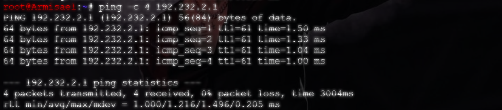
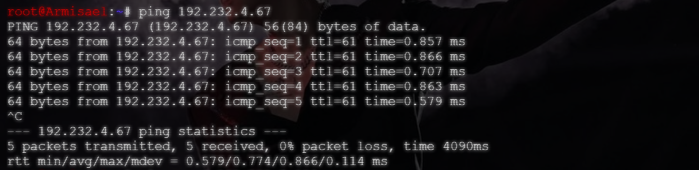
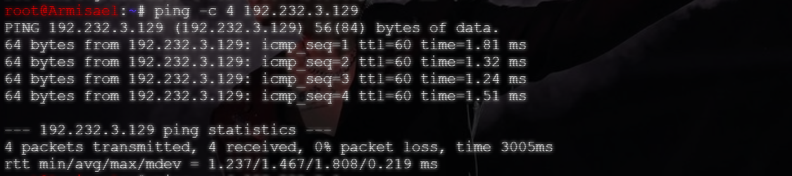

## Pemberian IP dan Gateway Sementara

Karena IP akan diberikan secara sementara, maka semua ini dijalankan di terminal dan TIDAK dimasukkan ke konfigurasi.

### Pada Armisael

```bash
ip addr add 192.232.4.73/29 dev eth0
ip link set dev eth0 up
ip route add default via 192.232.4.75
```

### Pada Lilith

```bash
ip addr add 192.232.4.66/29 dev eth0
ip link set dev eth0 up
ip route add default via 192.232.4.67
```

### Pada Sachiel

```bash
ip addr add 192.232.3.129/26 dev eth0
ip link set dev eth0 up
ip route add default via 192.232.3.190
```

### Pada Com-Net

```bash
ip addr add 192.232.2.1/24 dev eth0
ip link set dev eth0 up
ip route add default via 192.232.2.254
```

Selanjutnya, perlu juga untuk menambahkan jalur agar router lain dapat terhubung.

### Router Gendou

```bash
# Rute ke Comm-Net (LAN A12) via Router Hikari
ip route add 192.232.2.0/24 via 192.232.4.110

# Rute ke Sachiel (LAN A15) via Router Asuka
ip route add 192.232.3.128/26 via 192.232.4.118

# Rute ke Armisael (LAN A26) via Router Shigeru
ip route add 192.232.4.72/29 via 192.232.4.137

# Rute ke Lilith (LAN A29) via Router Fuyutsuki
ip route add 192.232.4.64/29 via 192.232.4.145
```

### Router Hikari

```bash
# Default route naik ke Gendou
ip route add default via 192.232.4.109
```

### Router Asuka

```bash
# Default route naik ke Gendou
ip route add default via 192.232.4.117

# Rute turun ke LAN Sachiel via Router Kensuke
ip route add 192.232.3.128/26 via 192.232.4.122
```

### Router Kensuke

```bash
# Default route naik ke Asuka
ip route add default via 192.232.4.121
```

### Router Shigeru

```bash
# Default route naik ke Gendou
ip route add default via 192.232.4.138
```

### Router Fuyutsuki

```bash
# Default route naik ke Gendou
ip route add default via 192.232.4.146

# Rute turun ke LAN Lilith via Router Toji
ip route add 192.232.4.64/29 via 192.232.4.150
```

### Router Toji

```bash
# Default route naik ke Fuyutsuki
ip route add default via 192.232.4.149
```

# Soal 4

## Apa yang terjadi?

Pada soal ini diminta agar seluruh node bisa mengakses internet melalui interface `eth0` Gendou-NAT1. Namun jangan gunakan `SNAT` karena IP NAT1 dapat berubah sewaktu-waktu.

Kemudian, pada NAT1 hanya satu subnet saja yang boleh menuju ke internet yang ada di NAT1, yakni `192.232.0.0`.

## Konfigurasi

Pada soal ini, diharuskan masuk ke router dan node agar bisa memasukkan konfigurasi baru. Jalankan script soal 4 yang ada pada masing-masing node/router, atau masukkan perintah ini ke terminal.

### Pada Gendou

```bash
ip link set dev eth0 up
sysctl -w net.ipv4.ip_forward=1
iptables -t nat -F
iptables -t nat -A POSTROUTING -s 192.232.0.0/21 -o eth0 -j MASQUERADE
```

### Pada Armisael

```bash
echo "nameserver 8.8.8.8" > /etc/resolv.conf
echo "nameserver 1.1.1.1" >> /etc/resolv.conf
```

### Pada Lilith

```bash
echo "nameserver 8.8.8.8" > /etc/resolv.conf
echo "nameserver 1.1.1.1" >> /etc/resolv.conf
```

### Membuat Konfigurasi Permanen

Apabila ingin menjadikan konfigurasi pada `Gendou` menjadi permanen, maka masuk ke `/etc/network/interfaces` milik Gendou.

```bash
auto eth0
iface eth0 inet dhcp
    up ip link set dev eth0 up
    up sysctl -w net.ipv4.ip_forward=1
    up iptables -t nat -A POSTROUTING -s 192.232.0.0/21 -o eth0 -j MASQUERADE
```

## Pengujian

Untuk menguji hasil konfigurasi, masuk ke masing-masing node `Armisael` dan `Lilith`, kemudian jalankan command berikut:

```bash
ping -c 2 8.8.8.8
ping -c 2 deb.debian.org
```

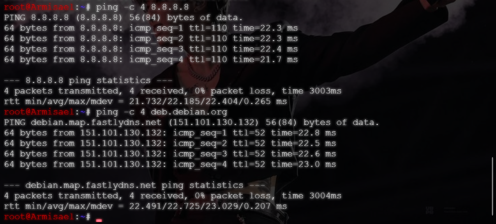
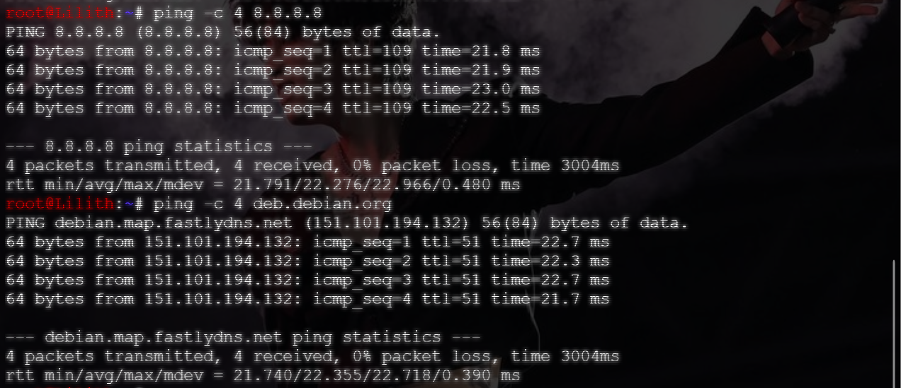

Kemudian lihat counter rule NAT pada Gendou.

```bash
iptables -t nat -L POSTROUTING -v -n
```

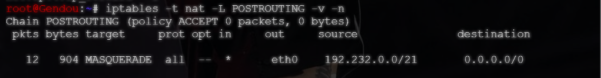
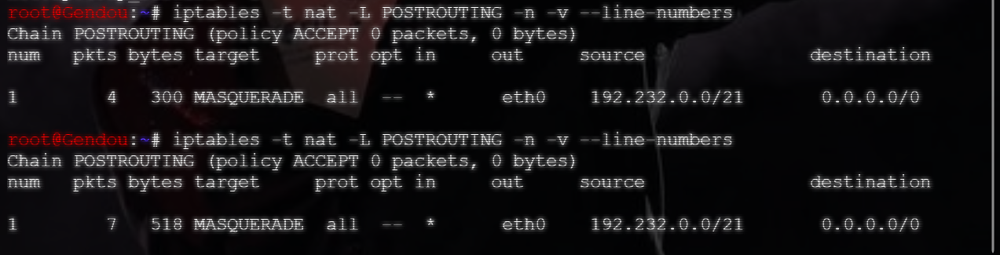

## Penjelasan

Pada Gendou, dapat dilihat kolom `pkts` yang menunjukkan seberapa banyak paket yang telah dikirimkan dari node. Karena setiap kali node mengirimkan paket ke domain, node pengirim belum memiliki cache IP `deb.debian.org` atau TTL-nya sudah habis. Maka dari itu sistem akan mengirim 1 paket DNS query menuju DNS Server yakni `8.8.8.8` sebelum paket ICMP echo request dikirim.

Namun balasan dari DNS Response-nya tidak akan menambah counter `POSTROUTING`, ini karena `POSTROUTING` hanya dilalui oleh paket keluar setelah keputusan routing dibuat.

# Soal 5

Pada soal 5, diminta untuk membuat aturan `firewall`. Yakni: semua lalu lintas di `INPUT` dan `FORWARD` akan ditolak, hanya mengizinkan paket balasan dari internet yang koneksinya diinisiasi oleh host internal, hanya mengizinkan subnet internal mengirim koneksi keluar melalui `FORWARD`, mengizinkan seluruh subnet untuk komunikasi di `FORWARD`, mengizinkan subnet internal menghubungi Gendou dengan `INPUT`, dan mengizinkan interface `lo` serta DHCP pada `eth0`.

## Script

Pada soal ini, diperlukan sebuah script di router `Gendou`.

```bash
#!/bin/sh

# 1. Aktifkan IP Forwarding
sysctl -w net.ipv4.ip_forward=1

# 2. Reset/Flush Rule & NAT Lama
iptables -F
iptables -X
iptables -t nat -F
iptables -t nat -X

# 3. Set Policy Default menjadi DROP pada INPUT dan FORWARD (OUTPUT tetap ACCEPT)
iptables -P INPUT DROP
iptables -P FORWARD DROP
iptables -P OUTPUT ACCEPT

# -------------------------------------------------------------
# RULE FILTERING (TABLE FILTER)
# -------------------------------------------------------------

# (a) Izinkan Loopback Interface
iptables -A INPUT -i lo -j ACCEPT

# (b) Izinkan DHCP dari NAT1 (eth0) agar Gendou tetap dapat IP DHCP
iptables -A INPUT -i eth0 -p udp --dport 68 --sport 67 -j ACCEPT

# (c) Poin (a): Izinkan Balasan Koneksi yang Sudah Ada (ESTABLISHED, RELATED)
iptables -A INPUT -m state --state ESTABLISHED,RELATED -j ACCEPT
iptables -A FORWARD -m state --state ESTABLISHED,RELATED -j ACCEPT

# (d) Poin (d): Izinkan Traffic dari Jaringan Internal (192.232.0.0/21) ke Gendou Sendiri
iptables -A INPUT -s 192.232.0.0/21 -j ACCEPT

# (e) Poin (b): Izinkan Traffic dari Jaringan Internal ke Internet via eth0
iptables -A FORWARD -s 192.232.0.0/21 -o eth0 -j ACCEPT

# (f) Poin (c): Izinkan Traffic Antar-LAN Internal
iptables -A FORWARD -s 192.232.0.0/21 -d 192.232.0.0/21 -j ACCEPT

# -------------------------------------------------------------
# RULE NAT (SOAL 4)
# -------------------------------------------------------------
# Masquerade traffic dari internal yang keluar via eth0
iptables -t nat -A POSTROUTING -s 192.232.0.0/21 -o eth0 -j MASQUERADE
```

## Pengujian

Untuk menguji soal 5, uji coba ping ke `8.8.8.8` dari Armisael dan juga jalankan `iptables -S` pada Gendou.

```bash
iptables -S
```

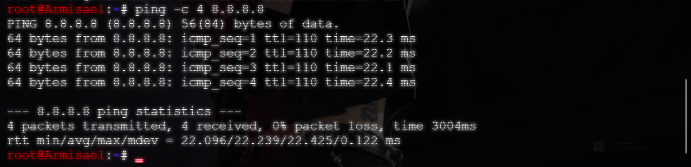
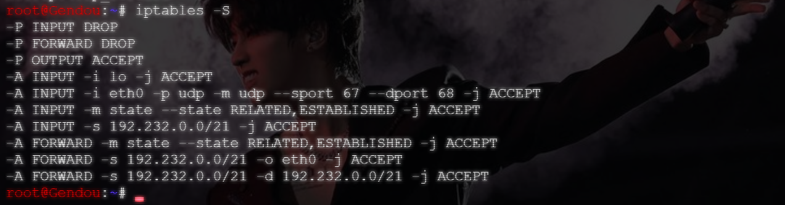

# Soal 6

## Konfigurasi Permanen Node

### Unit-01

```bash
auto lo
iface lo inet loopback
 
auto eth0
iface eth0 inet static
    address 192.232.4.65
    netmask 255.255.255.248
    gateway 192.232.4.70
    up ip link set dev eth0 up
```

### Unit-02

```bash
auto lo
iface lo inet loopback

auto eth0
iface eth0 inet static
    address 192.232.4.66
    netmask 255.255.255.248
    gateway 192.232.4.70
    up ip link set dev eth0 up
```

### Unit-00

```bash
auto lo
iface lo inet loopback

auto eth0
iface eth0 inet static
    address 192.232.4.67
    netmask 255.255.255.248
    gateway 192.232.4.70
    up ip link set dev eth0 up
```

### Garden-Staff

```bash
auto lo
iface lo inet loopback

auto eth0
iface eth0 inet static
    address 192.232.4.1
    netmask 255.255.255.224
    gateway 192.232.4.30
    up ip addr add 192.232.4.1/28 dev eth0
    up ip link set dev eth0 up
    ip route add default via 192.232.4.14
```

### Quarters

```bash
auto lo
iface lo inet loopback

auto eth0
iface eth0 inet static
    address 192.232.0.1
    netmask 255.255.254.0
    gateway 192.232.1.254
    up ip link set dev eth0 up
```

### Dock-Crew

```bash
auto lo
iface lo inet loopback

auto eth0
iface eth0 inet static
    address 192.232.4.33
    netmask 255.255.255.240
    gateway 192.232.4.46
    up ip link set dev eth0 up
```

### Hangar-Crew

```bash
auto lo
iface lo inet loopback

auto eth0
iface eth0 inet static
    address 192.232.3.1
    netmask 255.255.255.128
    gateway 192.232.3.126
    up ip link set dev eth0 up
```

### Relay-Node

```bash
auto lo
iface lo inet loopback

auto eth0
iface eth0 inet static
    address 192.232.3.225
    netmask 255.255.255.224
    gateway 192.232.3.254
    up ip link set dev eth0 up
```

### Comm-Net

```bash
auto lo
iface lo inet loopback

auto eth0
iface eth0 inet static
    address 192.232.2.1
    netmask 255.255.255.0
    gateway 192.232.2.254
    up ip link set dev eth0 up
```

### Sachiel

```bash
auto lo
iface lo inet loopback

auto eth0
iface eth0 inet static
    address 192.232.3.129
    netmask 255.255.255.192
    gateway 192.232.3.190
    up ip link set dev eth0 up
```

### Entry-Plug

```bash
auto lo
iface lo inet loopback

auto eth0
iface eth0 inet static
    address 192.232.4.49
    netmask 255.255.255.248
    gateway 192.232.4.54
    up ip link set dev eth0 up
```

### Dummy-Plug

```bash
auto lo
iface lo inet loopback

auto eth0
iface eth0 inet static
    address 192.232.4.50
    netmask 255.255.255.248
    gateway 192.232.4.54
    up ip link set dev eth0 up
```

### Archive-Vault

```bash
auto lo
iface lo inet loopback

auto eth0
iface eth0 inet static
    address 192.232.4.97
    netmask 255.255.255.252
    gateway 192.232.4.98
    up ip link set dev eth0 up
```

### Spy

```bash
auto lo
iface lo inet loopback

auto eth0
iface eth0 inet static
    address 192.232.4.101
    netmask 255.255.255.252
    gateway 192.232.4.102
    up ip link set dev eth0 up
```

### Radar-Array

```bash
auto lo
iface lo inet loopback

auto eth0
iface eth0 inet static
    address 192.232.4.73
    netmask 255.255.255.248
    gateway 192.232.4.78
    up ip link set dev eth0 up
```

### Zeruel

```bash
auto lo
iface lo inet loopback

auto eth0
iface eth0 inet static
    address 192.232.4.89
    netmask 255.255.255.248
    gateway 192.232.4.94
    up ip link set dev eth0 up
```

### Armisael

```bash
auto lo
iface lo inet loopback

auto eth0
iface eth0 inet static
    address 192.232.4.90
    netmask 255.255.255.248
    gateway 192.232.4.94
    up ip link set dev eth0 up
```

### Lilith

```bash
auto lo
iface lo inet loopback

auto eth0
iface eth0 inet static
    address 192.232.4.81
    netmask 255.255.255.248
    gateway 192.232.4.86
    up ip link set dev eth0 up
    up ip route add default via 192.232.4.86
```

### Adam

```bash
auto lo
iface lo inet loopback

auto eth0
iface eth0 inet static
    address 192.232.4.82
    netmask 255.255.255.248
    gateway 192.232.4.86
    up ip link set dev eth0 up
```

### Pen-Pen

```bash
auto lo
iface lo inet loopback

auto eth0
iface eth0 inet static
    address 192.232.3.193
    netmask 255.255.255.224
    gateway 192.232.3.222
    ip addr add 192.232.3.193/27 dev eth0
    up ip link set dev eth0 up
    ip route add default via 192.232.3.222
```

### Medic-Bay

```bash
auto lo
iface lo inet loopback

auto eth0
iface eth0 inet static
    address 192.232.3.194
    netmask 255.255.255.224
    gateway 192.232.3.222
    up ip link set dev eth0 up
```

### Magi-Casper

```bash
auto lo
iface lo inet loopback

auto eth0
iface eth0 inet static
    address 192.232.4.57
    netmask 255.255.255.248
    gateway 192.232.4.62
    up ip link set dev eth0 up
```

### Magi Balthasar

```bash
auto lo
iface lo inet loopback

auto eth0
iface eth0 inet static
    address 192.232.4.58
    netmask 255.255.255.248
    gateway 192.232.4.62
    up ip link set dev eth0 up
    up ip route add default via 192.232.4.46
```

### Magi Melchior

```bash
auto lo
iface lo inet loopback

auto eth0
iface eth0 inet static
    address 192.232.4.59
    netmask 255.255.255.248
    gateway 192.232.4.62
    up ip link set dev eth0 up
```

### Tokyo3-Core

```bash
auto lo
iface lo inet loopback

auto eth0
iface eth0 inet static
    address 192.232.4.105
    netmask 255.255.255.252
    gateway 192.232.4.106
    up ip link set dev eth0 up
```

## Pengujian

Untuk soal 6, pengujian dilakukan dengan menjalankan ping ke gateway dan IP Address node lain.

```bash
ping -c 4 <IP_ADDRESS>
```

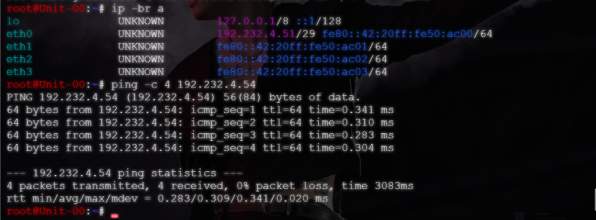

## Apabila Error

Apabila terjadi error, atau terjadi hal di bawah ini:

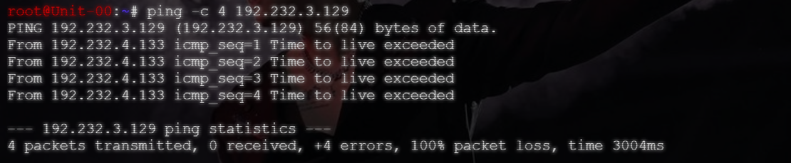

Tambahkan routing pada konfigurasi (melalui GNS3 agar PERMANEN), dan jalankan juga pada terminal apabila hanya butuh untuk sementara.

### Untuk konfigurasi

```bash
up ip route add <IP_Address_Yang_Dituju> via <Jalur_IP_Address_Dari_Routernya>
```

### Untuk terminal

```bash
ip route add <IP_Address_Yang_Dituju> via <Jalur_IP_Address_Dari_Routernya>
```

Contohnya:

Pada gambar di bawah ini, Router `Asuka` tidak memiliki routing ke next-hop, A15.

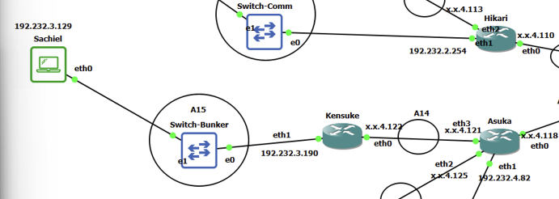
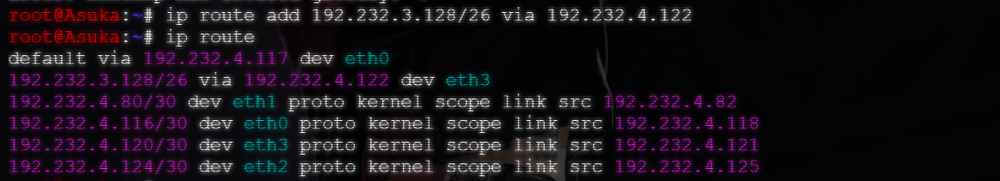

# Soal 7

## Apa yang terjadi?

Pada soal ini diminta untuk mengaktifkan listener (daemon) pada node `Casper`, `Balthasar`, dan `Melchior`.

### Uji Coba Listener

Jalankan script yang telah dibuat pada node Balthasar, Casper, dan Melchior. Apabila listener telah berjalan, kirimkan pesan dari node `Lilith` dan cek log-nya.

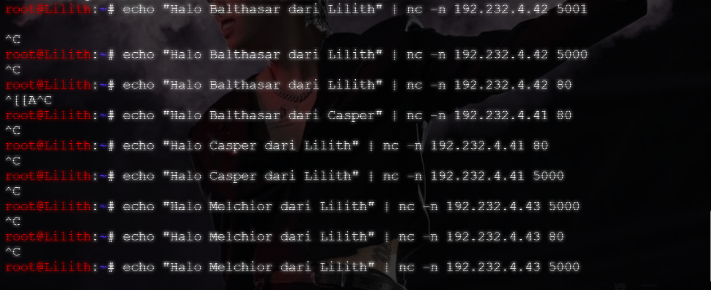

#### Kirimkan ke Casper

```bash
echo "Pesan dari Lilith ke Casper Port 5000" | nc -n 192.232.4.57 5000
```


#### Kirimkan ke Balthasar

```bash
echo "Pesan dari Lilith ke Balthasar Port 5000" | nc -n 192.232.4.58 5000
echo "Pesan dari Lilith ke Balthasar Port 5001" | nc -n 192.232.4.58 5001
```


#### Kirimkan ke Melchior

```bash
echo "Pesan dari Lilith ke Melchior Port 5000" | nc -n 192.232.4.59 5000
```


Apabila sudah, lakukan pengecekan dari masing-masing node `Magi` dan matikan listener apabila telah selesai.

```bash
pkill -f "melchior.sh"
kill 409 2>/dev/null || killall nc 2>/dev/null
```

```bash
pkill -f "balthasar.sh"
kill 409 2>/dev/null || killall nc 2>/dev/null
```

```bash
pkill -f "casper.sh"
kill 409 2>/dev/null || killall nc 2>/dev/null
```

# Soal 8

## Pengecekan pada Lilith

Agar dapat menjalankan Listener dan `Lilith`, `Pen-Pen` serta `Tokyo3-Core` berhasil terhubung, uji coba dengan `ping`.

```bash
# Jalankan pada Lilith
ping -c 2 192.232.3.193
ping -c 2 192.232.4.89
```

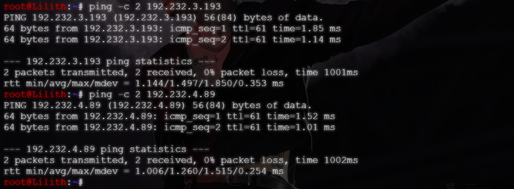

## Menjalankan Listener

### Jalankan Script

Jalankan script `penpen.sh` dan `tokyo.sh` yang sudah ada. Berikut penjelasannya.

### Pen-Pen

```bash
killall nc 2>/dev/null
while true; do
  printf "Welcome to Pen-Pen\n" | nc -l -n -p 80
done
```


Apabila ini sudah jalan pada node `Pen-Pen`, beralih ke node `Lilith` untuk mengirim pesan. Kirimkan pesan kosong pada `Pen-Pen`.

```bash
echo "" | nc -n -w 2 192.232.3.193 80
```

Uji coba berhasil apabila terminal mengembalikan pesan `Welcome to Pen-Pen`.


### Tokyo3

Hal yang sama dilakukan pada node `Tokyo3-Core`.

#### Untuk port 80

```bash
killall nc 2>/dev/null
while true; do
  printf "Welcome to Tokyo3-Core\n" | nc -l -n -p 80
done
```

#### Untuk port 8080

```bash
killall nc 2>/dev/null
while true; do
  printf "syifa imutz\n" | nc -l -n -p 8080
done
```

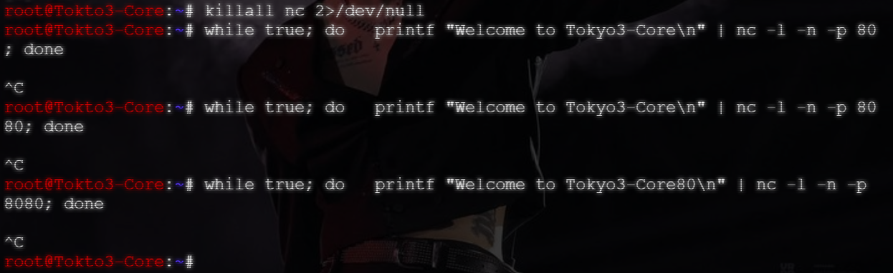

Setelah berhasil dilakukan, masuk lagi ke node `Lilith` dan kirimkan pesan kosong.

```bash
echo "" | nc -n -w 2 192.232.4.106 80
echo "" | nc -n -w 2 192.232.4.106 8080
```


### Pada Port yang Dilarang

Uji coba pada port 22:

```bash
nc -n -v -w 2 192.232.4.106 22
```

# Soal 9

## Pengecekan

Setelah script dijalankan, jalankan tes ping dari node `Lilith`.

```bash
# Jalankan ping ke Armisael
ping -c 4 192.232.4.73
```

Kemudian jalankan pula tes ping dari node `Armisael`.

```bash
ping -c 4 192.232.4.94
```

## Perbaikan

```bash
# 1. Hapus Policy Routing (Rule 90) & Flush Tabel 100
ip rule del iif eth1 lookup 100 2>/dev/null
ip rule del priority 90 2>/dev/null
ip route flush table 100 2>/dev/null

# 2. Hapus Rute Blackhole ke Subnet LAN Armisael
ip route del blackhole 192.232.4.72/29 2>/dev/null

# 3. Kembalikan Default Route Shigeru ke Induk (Gendou)
# Catatan: IP Gateway Gendou pada link ke Shigeru adalah 192.232.4.138 (Link A19)
ip route replace default via 192.232.4.138

# 4. Pastikan Rute ke Subnet Makoto (LAN A25: 192.232.4.56/29) Mengarah ke IP Makoto (.142)
ip route add 192.232.4.56/29 via 192.232.4.142 2>/dev/null

# 5. Aktifkan Kembali IP Forwarding
sysctl -w net.ipv4.ip_forward=1
```

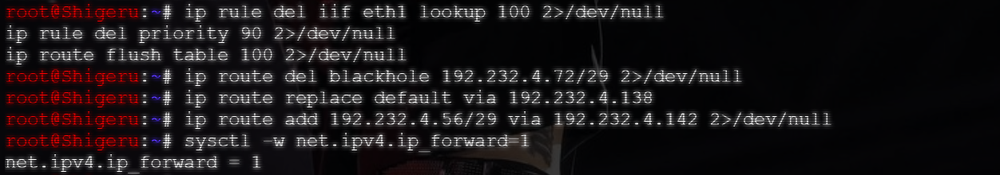
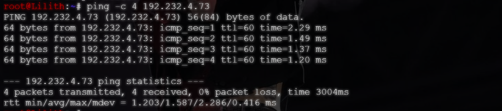

## Penjelasan

- Mengapa Armisael masih bisa ping ke gateway-nya sendiri?
  Karena link lokal antara Armisael dan interface LAN Shigeru berada dalam satu segmen, sehingga tidak membutuhkan IP forwarding maupun tabel routing eksternal.

- Mengapa Lilith tidak mendapat balasan dari Armisael?
  Paket dari Lilith menuju Armisael terhenti di Shigeru karena aturan `blackhole` membuang paket tersebut, ditambah aturan `ip rule` dan matinya `ip_forward` pada Shigeru yang memutus komunikasi dua arah.

# Soal 10

## Pengecekan

### Node

Setelah `break_nat.sh` dijalankan, lakukan pengecekan pada router Misato dan Gendou.

### Router Misato

Pada router `Misato`, lakukan pengecekan dengan `iptables` untuk menampilkan seluruh aturan di rantai `POSTROUTING` pada tabel `nat`. Dengan perintah ini juga dapat mengetahui rule SNAT ke `172.31.99.1` berada di baris berapa.

```bash
iptables -t nat -L POSTROUTING -n -v --line-numbers
```

Kemudian hapus rule SNAT-nya.

```bash
iptables -t nat -D POSTROUTING 1
```

Verifikasi ulang dengan `iptables` yang telah dilakukan tadi.

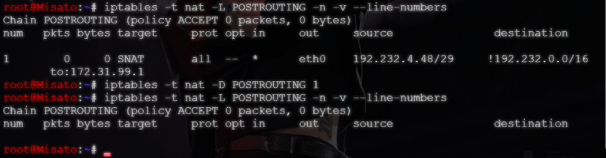

### Router Gendou

Jalankan pengujian/pengecekan awal di Gendou.

```bash
iptables -t nat -L POSTROUTING -n -v --line-numbers
```

Kemudian hapus sesuai dengan baris yang dikeluarkan oleh `iptables`.

```bash
iptables -t nat -D POSTROUTING 1

# Pastikan pula NAT yang keluar via WAN Gendou tetap aktif
iptables -t nat -A POSTROUTING -s 192.232.0.0/21 -o eth0 -j MASQUERADE 2>/dev/null || true
```

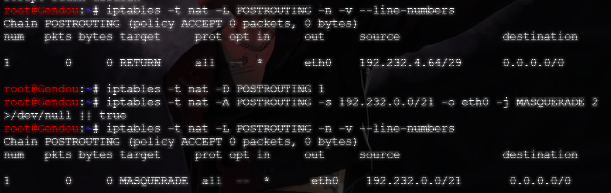

## Pengujian

Lakukan pengujian dari node `Unit-00`, `Unit-01`, dan `Unit-02`.

```bash
ping -c 4 8.8.8.8
```

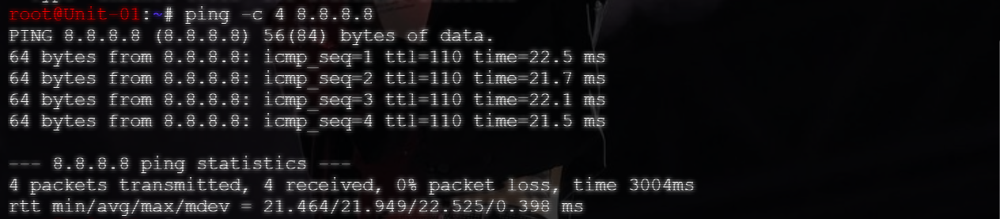

# Soal 11

## Pendahuluan

Pada soal ini, kita kurang lebih membuat node Casper menjadi hantu. Di mana tidak ada perangkat lain yang boleh mem-ping Casper, termasuk yang satu switch. Casper sendiri tetap boleh mem-ping siapa saja. Layanan TCP 5000 Casper tetap hidup. Buktikan ping ke Casper dari Balthasar dan Lilith gagal, sedangkan ping dari Casper ke keduanya berhasil.

## Penyelesaian

Untuk membuat Casper tidak bisa di-ping oleh perangkat lain, firewall harus dipasang di Casper sendiri, bukan di router. Balthasar dan Melchior satu switch dengan Casper, jadi paket mereka tidak lewat router mana pun.

Yang diblok hanya `echo-request` yang masuk. Untuk melakukan ini, tambahkan beberapa baris baru pada script yang sudah ada dari soal 7 untuk Casper.

Pada `casper.sh`, tambahkan:

```bash
iptables -C INPUT -p icmp --icmp-type echo-request -j DROP 2>/dev/null || \
iptables -I INPUT 1 -p icmp --icmp-type echo-request -j DROP
```

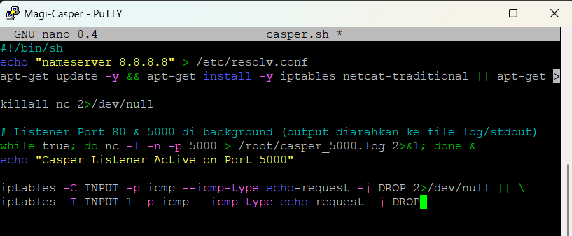

## Pembuktian

Di Balthasar & Lilith:

```bash
ping -c 3 -W 2 192.232.4.57
```

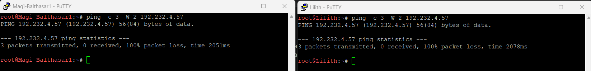

Di Casper (Ping Balthasar & Lilith):

```bash
ping -c 3 192.232.4.58
ping -c 3 192.232.4.81
```

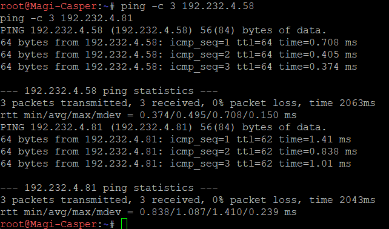

Bisa terlihat Balthasar dan Lilith gagal untuk ping Casper dengan 100% packet loss, sedangkan Casper dapat ping Balthasar dan Lilith tanpa masalah.

# Soal 12

## Pendahuluan

Jalankan `break_fw.sh` di Magi-Casper, lalu perbaiki tanpa membatalkan tujuan hardening. Casper tetap menolak semua lalu lintas masuk yang tidak diizinkan, dan policy `INPUT` tetap `DROP`. Buktikan `nc` dari Unit-00 ke Casper port 5000 berhasil dan `apt-get update` di Casper berhasil.

## Penyelesaian

Pertama kita tambahkan `break_fw.sh` yang terdapat pada soal di dalam root-nya Casper lalu jalankan.

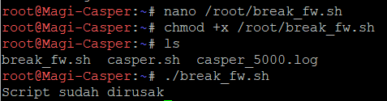

Setelah rusak, kita sekarang perlu recovery Casper seperti semula. Untuk itu, kita lakukan diagnosis apa saja yang rusak terlebih dahulu:

```bash
iptables -S
iptables -L INPUT -v -n --line-numbers
iptables -L OUTPUT -v -n --line-numbers
ping -c 2 -W 2 8.8.8.8
iptables -L INPUT -v -n
getent hosts deb.debian.org
iptables -L OUTPUT -v -n
```

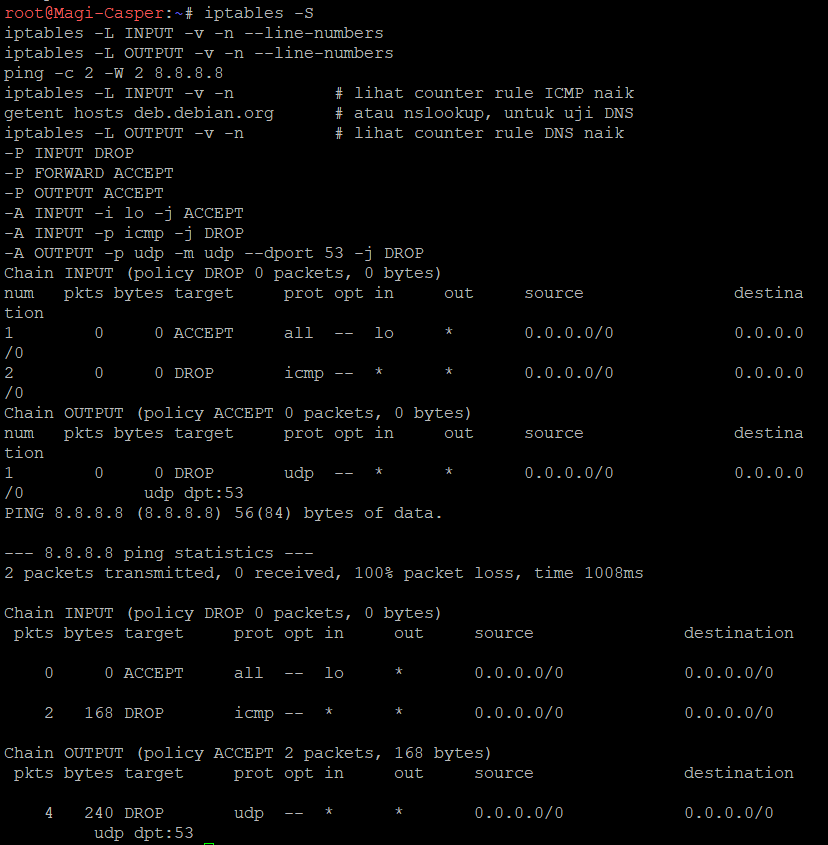

Di sini kita bisa melihat apa saja yang rusak, misalnya ping `8.8.8.8` tidak bisa dengan 100% packet loss.

Untuk memperbaikinya dengan tetap menetapkan hardening pada soal-soal sebelumnya, di mana policy `INPUT DROP`, ping masuk ke Casper tetap ditolak, dan lalu lintas masuk lain yang tidak diizinkan tetap tertolak. Untuk menetapkan hardening-nya dan memperbaiki Casper tersendiri, kita dapat jalankan berikut:

```bash
iptables -F INPUT
iptables -F OUTPUT
iptables -A INPUT -i lo -j ACCEPT
iptables -A INPUT -p icmp --icmp-type echo-request -j DROP
iptables -A INPUT -m conntrack --ctstate ESTABLISHED,RELATED -j ACCEPT
iptables -A INPUT -p tcp --dport 5000 -j ACCEPT
iptables -P INPUT DROP
```

Di sini urutannya penting: rule `DROP` untuk `echo-request` berada di depan rule `ESTABLISHED`, jadi ping masuk dari node lain tetap ditolak. Ini sekaligus mengembalikan syarat nomor 11. Echo-reply untuk ping yang Casper kirim sendiri lolos lewat rule `ESTABLISHED`.

## Pembuktian

Setelah perbaikan, untuk melakukan verifikasi bahwa sudah normal, kita jalankan berikut sesuai dengan soalnya:

```bash
ping -c 3 8.8.8.8
apt-get update
iptables -S
```

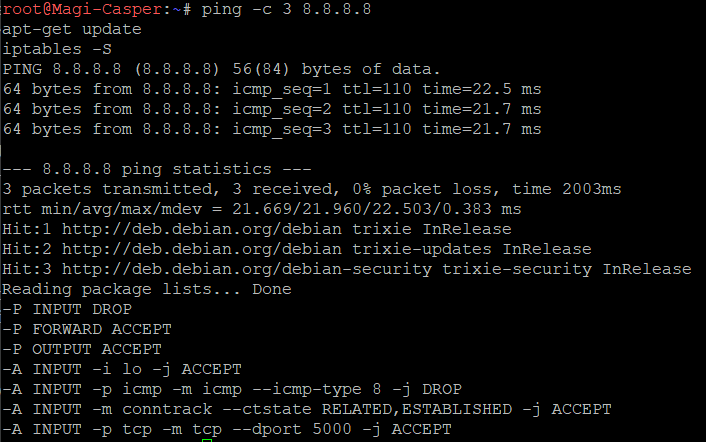

Di sini terlihat ping `8.8.8.8` kembali berfungsi, `apt-get update` juga berhasil dan kita bisa melihat aturan `iptables`-nya.

Sebelum kita uji coba `nc`, kita buatkan log pada Casper terlebih dahulu dengan:

```bash
while true; do nc -l -p 5000 >> /root/casper-5000.log; done &
```

Lalu, pada node Unit-00, kita jalankan:

```bash
echo halo | nc -w 3 192.232.4.57 5000; echo $?
```

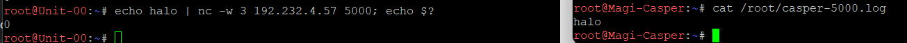

Bisa terlihat shell mengembalikan `0` yang berarti sukses dan jika kita lihat pada log Casper kita bisa melihat `echo halo` dari Unit-00-nya.

# Soal 13

## Pendahuluan

Pada Balthasar, hanya Casper dan semua Pilot yang boleh menyambung ke TCP 5000 dan 5001. Node lain, termasuk yang satu switch, harus langsung ditolak di kedua port itu, bukan dibiarkan menggantung sampai timeout. Lalu lintas lain tidak boleh terganggu. Balthasar tetap harus bisa ping `8.8.8.8` dan menerima balasannya. Buktikan `nc` ke port 5000 dan 5001: Unit-01 berhasil, Lilith dan Melchior ditolak seketika.

## Penyelesaian

Mirip seperti Casper, supaya hanya Casper dan semua Pilot bisa mengakses Balthasar, kita pasang firewall pada Balthasar-nya sendiri karena Melchior dan Casper satu switch dengannya. Paket mereka tidak lewat router, jadi tidak bisa dicegat di tempat lain.

Maka, untuk membuat firewall ini kita cukup menambahkan beberapa baris baru pada `balthasar.sh` yang berisi firewall dan daftar IP Casper serta Pilot-Pilotnya. Kita cukup tambahkan baris-baris berikut setelah pemasangan iptables dan sebelum listener.

```bash
CASPER=192.232.4.57
PILOTS="192.232.4.65 192.232.4.66 192.232.4.67 192.232.3.129"   # Unit-01, Unit-02, Unit-00, Sachiel

iptables -F INPUT
for ip in $CASPER $PILOTS; do
  iptables -A INPUT -p tcp -m multiport --dports 5000,5001 -s $ip -j ACCEPT
done
iptables -A INPUT -p tcp -m multiport --dports 5000,5001 -j REJECT --reject-with tcp-reset
```

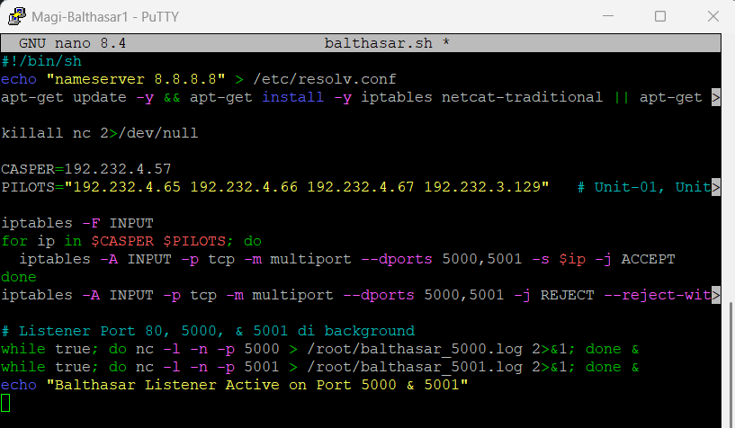

Lalu kita pasang ulang listener dengan pola loop dengan log yang mirip seperti Casper pada nomor 12.

```bash
while true; do nc -l -p 5000 >> /root/balthasar-5000.log; done &
while true; do nc -l -p 5001 >> /root/balthasar-5001.log; done &
```

## Pembuktian

Dari Unit-01, Lilith, dan Melchior jalankan:

```bash
time (echo halo | nc -w 3 192.232.4.58 5000); echo $?
time (echo halo | nc -w 3 192.232.4.58 5001); echo $?
```

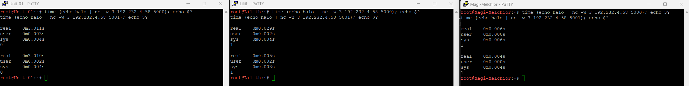

Di sini terlihat `nc` yang diterima hanya dari pilot (Unit-01) dengan exit code `0`, sedangkan untuk Lilith dan Melchior exit status mereka `1` yang berarti mereka ditolak seketika.

Kita juga lakukan pembuktian lanjutan pada Balthasar dengan memastikan tetap bisa ping `8.8.8.8` dan menerima balasannya.

```bash
cat /root/balthasar-5000.log /root/balthasar-5001.log   # hanya halo dari Unit-01
iptables -L INPUT -v -n --line-numbers                  # pkts rule REJECT naik
ping -c 3 8.8.8.8                                       # tetap berhasil
```

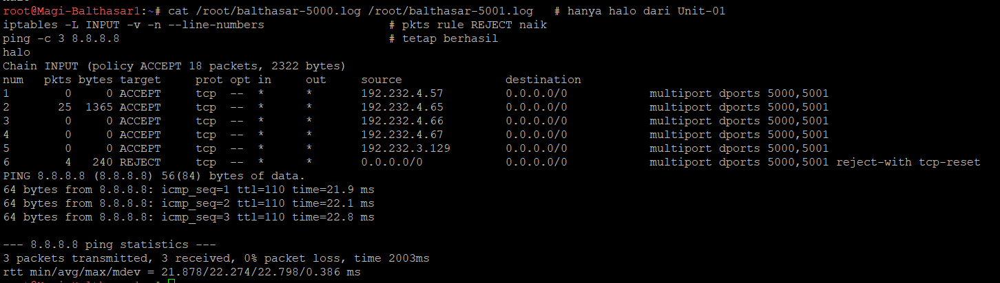

Di sini bisa terlihat pesan `halo` dari Unit-01, aturan `iptables` Balthasar yang menerima dari Casper dan semua pilot serta menolak lainnya, dan tetap dapat melakukan ping `8.8.8.8`.

# Soal 14

## Pendahuluan

Pada soal 14 ini, kita harus membuat jadwal kunjungan Pen-Pen dengan ketentuan yang terdapat pada soalnya. Lalu simpan jadwal sebagai variabel di awal script Pen-Pen, bernama `PILOT_START`, `PILOT_STOP`, `PILOT_DAYS`, `STAF_START`, dan `STAF_STOP`. Untuk uji, ubah variabel itu sampai jadwalnya cocok dengan jam sekarang, lalu sampai tidak cocok. Ingat, `iptables` membaca jam UTC, 7 jam lebih lambat dari WIB. Tunjukkan hasil ping dari Unit-01, Lilith, dan Spy pada kedua kondisi.

## Penyelesaian

Pertama, kita perlu membuat jadwalnya terlebih dahulu dalam bentuk script, di mana kita membuat dan menjalankan script `soal14_penpen.sh`.

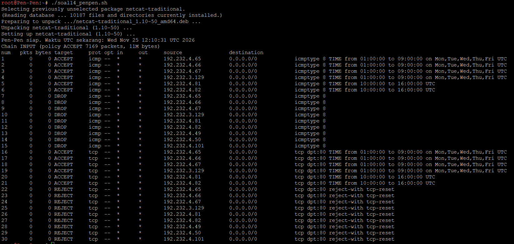

Script sudah dijalankan, sekarang masuk ke pembuktian.

## Pembuktian

Untuk melakukan pembuktian, kita jalankan berikut pada Unit-01, Lilith, dan Spy:

```bash
# dari Unit-01, Lilith, dan Spy
ping -c 3 -W 2 192.232.3.193
echo halo | nc -w 3 192.232.3.193 80; echo $?
```

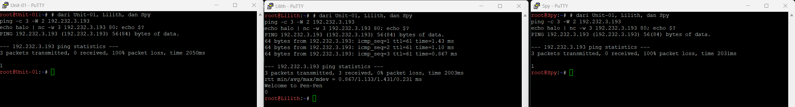

Pada waktu testing:

```bash
root@Pen-Pen:~# date -u
Wed Nov 25 12:19:21 UTC 2026
```

Hasilnya adalah Unit-01 ditolak, Lilith diterima dan disambut masuk, dan Spy ditolak.

Jadwalnya:
- Unit-01 (Pilot): jendela `01:00-09:00` sudah lewat
- Lilith (Staf): masuk jendela `10:00-16:00`
- Spy (Dummy): tidak pernah

# Soal 15

## Pendahuluan

Batasi Tokyo3-Core agar hanya menjawab maksimal 5 ping per detik, dan buang kelebihannya. Aturan ini tidak boleh mengganggu ping di bawah batas. Aturan ini juga tidak boleh membatasi ping yang dikirim Tokyo3-Core sendiri. Pastikan rule benar-benar mengenai paket yang dituju. Periksa urutan rule dan jenis paketnya. Buktikan ping rapat dari Lilith, misalnya `ping -i 0.1 -c 50`, sebagian hilang, dan tunjukkan counter rule pembuangan naik. Buktikan ping biasa semuanya berhasil, dengan jeda minimal 3 detik di antaranya.

## Penyelesaian

Kita implementasikan peraturan-peraturan dari soalnya di dalam script `soal15_tokyo.sh`.

Setelah script-nya dijalankan, kita lakukan pembuktian.

## Pembuktian

Langkah-langkah pembuktian:

1. Reset counter di Tokyo3-Core sebelum uji:

```bash
iptables -Z INPUT
```

2. Ping rapat dari Lilith (10 ping per detik, sebagian harus hilang):

```bash
ping -i 0.1 -c 50 192.232.4.105
```

3. Counter di Tokyo3-Core:

```bash
iptables -L INPUT -v -n --line-numbers
```

4. Ping biasa semuanya harus berhasil, dengan jeda 3 detik:

```bash
ping -i 3 -c 5 192.232.4.105
```

5. Ping dari Tokyo3-Core sendiri tidak dibatasi. Di Tokyo3-Core:

```bash
ping -i 0.1 -c 30 192.232.4.81
```

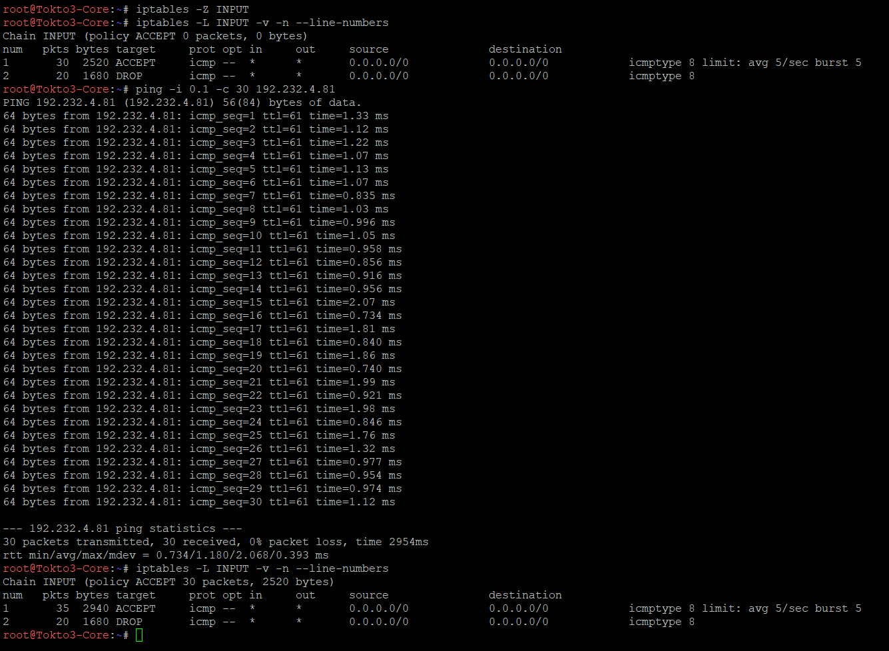
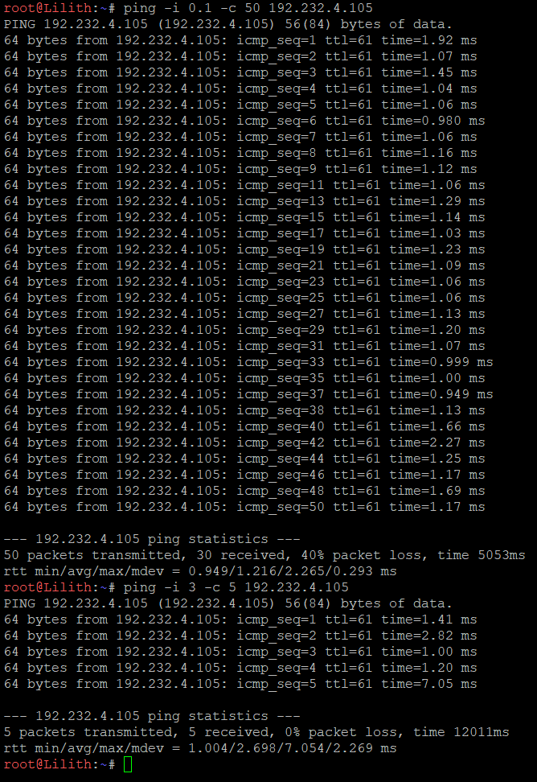

Di sini terlihat hasil dari pembuktiannya, di mana untuk setiap nomor ekspektasi pembuktiannya adalah sebagai berikut:
1. Hanya untuk reset counter.
2. Adanya sekitar 40% packet loss yang benar-benar terjadi sesuai yang terlihat pada gambar.
3. Kolom `pkts` pada rule `DROP` naik sekitar 20 dan terlihat terbukti.
4. Hasilnya 0% packet loss yang terbukti.
5. Hasilnya 0% packet loss dan counter `DROP` tidak bertambah.

# Soal 16

## Pendahuluan

Ritsuko ingin tahu setiap percobaannya, dan pintunya harus dibanting. Setiap koneksi TCP dari Dummy-Plug ke port 22, 23, dan 3306 di Tokyo3-Core harus dicatat di log dengan prefix huruf besar `SCAN-NERV:`, lalu ditolak seketika. Port 80 dan 8080 tetap bisa diakses, dan klien lain tidak boleh terganggu. Buktikan `nc -w` dari Dummy-Plug ke port 22, 23, dan 3306 langsung ditolak, dan ke port 80 dan 8080 berhasil. Tunjukkan counter rule pencatatan, karena log kernel sering tidak terlihat di container.

## Penyelesaian

Kita jalankan script `soal16_tokyo.sh` yang memodifikasi script `soal15_tokyo.sh`. Setelah dijalankan, kita lakukan pembuktian.

## Pembuktian

Dari Dummy-Plug, mengetes port sensitif yang harus ditolak:

```bash
for p in 22 23 3306; do
  time (nc -w 3 192.232.4.105 $p </dev/null); echo "port $p exit=$?"
done
```

Dari Dummy-Plug lagi, port layanan tetap hidup:

```bash
echo halo | nc -w 3 192.232.4.105 80; echo $?
echo halo | nc -w 3 192.232.4.105 8080; echo $?
```

Dari Lilith, harusnya tak terganggu dan menghasilkan exit `0`:

```bash
echo halo | nc -w 3 192.232.4.105 80; echo $?
```

Di Tokyo3-Core, tampil counter rule pencatatan di mana `pkts`-nya harusnya naik 3:

```bash
iptables -L INPUT -v -n --line-numbers
```

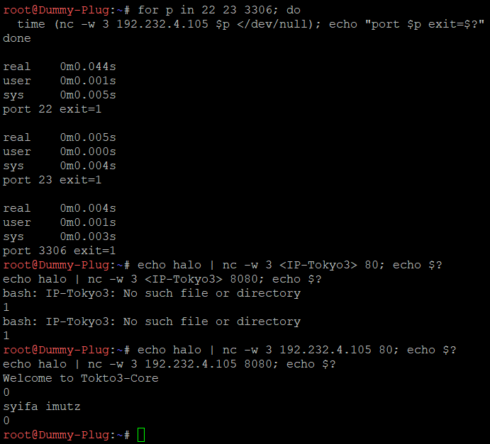
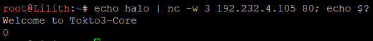
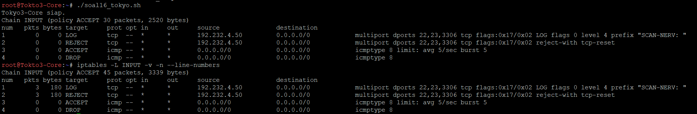

Di sini terlihat bahwa semua hasilnya sudah sesuai dengan ekspektasi, di mana pada Dummy-Plug semua port sensitif menghasilkan exit code `1` (ditolak seketika), port layanannya (80 dan 8080) tetap hidup dengan exit code `0` dan pesan masuk. Di Lilith juga menghasilkan exit code `0` yang berarti tidak terganggu, dan di Tokyo3-Core terlihat counter `pkts` yang awalnya `0` naik menjadi `3`.

# Soal 17

## Pendahuluan

Di Fuyutsuki, alihkan setiap koneksi TCP dari Magi-Casper ke Zeruel supaya sampai di Pen-Pen. Casper tidak boleh sadar. Balasan yang ia terima harus tetap terlihat datang dari Zeruel. Ping tidak dialihkan. Nyalakan listener port 9000 di Pen-Pen dan Zeruel. Dari Casper, kirim pesan ke IP Zeruel port 9000. Buktikan pesan itu muncul di Pen-Pen, bukan di Zeruel. Tunjukkan juga tabel `conntrack` di Fuyutsuki.

## Penyelesaian

Untuk soal ini kita jalankan script `soal17_fuyutsuki.sh`.

Setelah menjalankan script, kita buat listener port 9000 di Pen-Pen dan Zeruel dengan menggunakan:

```bash
cat > /root/listener9000.sh <<'EOF'
#!/bin/sh
while true; do
  nc -l -p 9000 >> /root/port9000-$(hostname).log
done
EOF
chmod +x /root/listener9000.sh
nohup /root/listener9000.sh >/dev/null 2>&1 &
```

Setelah membuat log untuk port 9000, kita lanjut ke pembuktian.

## Pembuktian

Di Casper, kita jalankan berikut untuk mengirim pesan ke IP Zeruel dan bukan IP Pen-Pen. Hasil yang harusnya terjadi yaitu di log Zeruel tetap kosong tetapi di log Pen-Pen akan berisi `"pesan rahasia dari Casper"`:

```bash
echo "pesan rahasia dari Casper" | nc -w 3 192.232.4.89 9000; echo $?
```

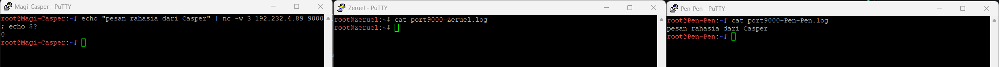

Di sini terlihat dan terbukti kalau log Zeruel kosong tetapi Pen-Pen berisi pesan rahasianya.

Dan untuk membuktikan kalau ping itu tidak dialihkan, di Casper lagi kita jalankan ping ke Zeruel:

```bash
ping -c 3 192.232.4.89
```

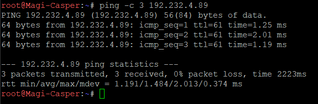

Ping masih aman dan mendapat balasan dari Zeruel.

Berikut kita coba mendapatkan tabel `conntrack` di Fuyutsuki dengan menjalankan:

```bash
conntrack -L -p tcp --dport 9000
```

Ini harus dijalankan secara cepat setelah mengirim pesan rahasia Casper tadi.

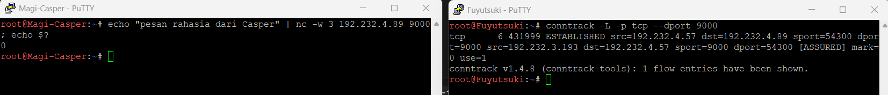

Terlihat IP source-nya dari Casper (`192.232.4.57`) dan destinasinya Zeruel (`192.232.4.89`).

# Soal 18

## Pendahuluan

Pasang aturan di Shigeru. Node di dalam zona boleh memulai koneksi ke mana saja, dan balasannya tetap sampai. Node di luar zona tidak boleh memulai koneksi ke dalam zona. Satu pengecualian: ping dari subnet Terminal boleh masuk. Tolak berdasarkan arah datangnya, yaitu semua yang datang dari sisi Shigeru yang menghadap Gendou. Jangan menulis subnet luar satu per satu, supaya subnet baru langsung ikut terblokir. Buktikan ping Casper ke Zeruel berhasil, sedangkan ping Lilith ke Zeruel gagal.

## Penyelesaian

Kita jalankan script `soal18_shigeru.sh` terlebih dahulu.

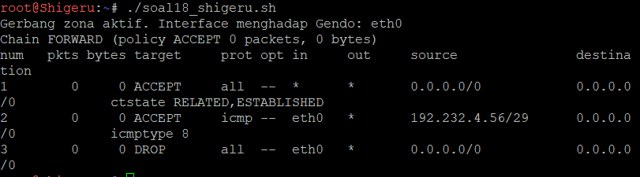

Kita bisa melihat status awal setelah menjalankan script-nya, lalu kita masuk ke pembuktian.

## Pembuktian

Untuk pembuktian, kita melakukan ping antar-node untuk memastikan peraturannya berhasil.

Casper ke Zeruel berhasil:

```bash
ping -c 3 -W 2 192.232.4.89      # dari Casper
```

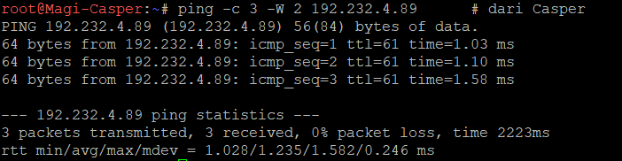

Berhasil dengan 0% packet loss. Selanjutnya,

Lilith ke Zeruel gagal:

```bash
ping -c 3 -W 2 192.232.4.89      # dari Lilith
```

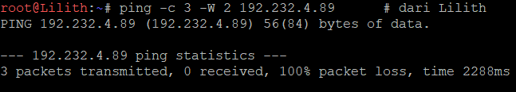

Gagal dengan 100% packet loss. Terakhir,

Kita cek counter di Shigeru:

```bash
iptables -L FORWARD -v -n --line-numbers
```

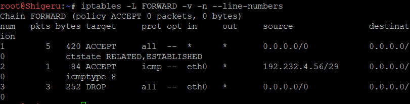

Di sini kita bisa bandingkan dengan status awalnya, di mana rule nomor 2 (`ACCEPT` dari Terminal) naik karena ping Casper, dan rule nomor 3 (`DROP`) naik karena ping Lilith.

# Soal 19

## Pendahuluan

Armisael tidak boleh lagi bicara dengan siapa pun, tapi Zeruel di sebelahnya tidak boleh ikut terhukum. Blokir semua lalu lintas masuk dan keluar Armisael, termasuk ke gateway dan tetangga satu switch. Isolasi tidak boleh dikerjakan di dalam Armisael, karena pengkhianat tidak bisa dipercaya. Untuk uji `nc`, nyalakan listener TCP 9000 di Armisael, Zeruel, dan Lilith. Ke Seele pakai TCP 53. Buktikan ping dan `nc` dari Armisael ke Seele, Zeruel, dan Lilith gagal. Buktikan ping dan `nc` dari Zeruel ke Seele dan Lilith berhasil.

## Penyelesaian

Kita menjalankan script `soal19_shigeru.sh` untuk override peraturan sebelumnya.

Setelah menjalankan script untuk Shigeru, kita jalankan script untuk Zeruel dengan `soal19_zeruel.sh`.

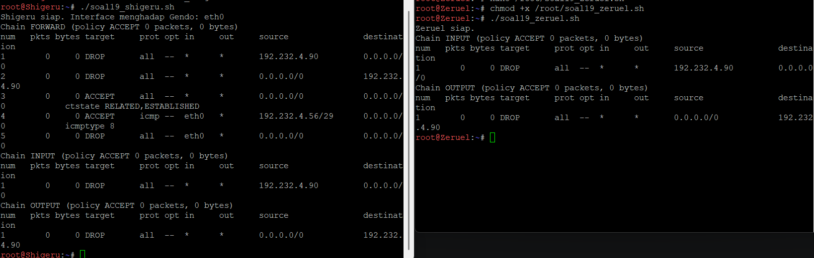

Dan terakhir sebelum pembuktian, kita buat listener untuk uji `nc` di Armisael, Zeruel, dan Lilith. Berikut dijalankan di Armisael dan Lilith saja dikarenakan Zeruel sudah memiliki listener dari soal 17:

```bash
cat > /root/listener9000.sh <<'EOF'
#!/bin/sh
while true; do
  nc -l -p 9000 >> /root/port9000-$(hostname).log
done
EOF
chmod +x /root/listener9000.sh
nohup /root/listener9000.sh >/dev/null 2>&1 &
```


Setelah itu, kita siap melakukan pembuktian.

## Pembuktian

Dari Armisael, semuanya harus gagal:

```bash
ping -c 3 -W 2 8.8.8.8
ping -c 3 -W 2 192.232.4.89          # Zeruel
ping -c 3 -W 2 192.232.4.81
nc -w 3 8.8.8.8 53 </dev/null; echo $?
nc -w 3 192.232.4.89 9000 </dev/null; echo $?
nc -w 3 192.232.4.81 9000 </dev/null; echo $?
```


Di sini kita bisa melihat untuk semua ping-nya gagal dengan 100% packet loss dan untuk ketiga `nc`-nya menghasilkan exit code `1` yang berarti gagal.

Berikut dari Zeruel, ke Seele dan Lilith harus berhasil:

```bash
ping -c 3 -W 2 8.8.8.8
ping -c 3 -W 2 192.232.4.81
nc -w 3 8.8.8.8 53 </dev/null; echo $?
echo halo | nc -w 3 192.232.4.81 9000; echo $?
```


Terbukti semuanya berhasil dengan 0% packet loss untuk ping-nya dan menampilkan exit code `0` yang berarti berhasil.

# Soal 20

## Persiapan

Sebelum memulai soal 20, pastikan soal 1-19 sudah running dan siap digunakan. Kemudian pastikan pula script untuk `Gendou`, `Lilith`, dan `Magi-Casper`.

## Uji Coba

### Router `Gendou` dan node `Casper`

#### Running Simulasi

Pada `Gendou` dan `Casper`, jalankan simulasi untuk flush total dan penghapusan rute.

```bash
iptables -P INPUT ACCEPT
iptables -P FORWARD ACCEPT
iptables -P OUTPUT ACCEPT
iptables -F && iptables -X
iptables -t nat -F && iptables -t nat -X
```


Apabila sudah, lakukan pengecekan pada filtering dan NAT-nya.

```bash
iptables -S
iptables -t nat -S
```

Output yang diharapkan adalah tabel filter-nya hanya berisi `INPUT`, `FORWARD`, dan `OUTPUT`. Sementara untuk NAT hanya berisi `PREROUTING`, `INPUT`, `OUTPUT`, dan `POSTROUTING`.

#### Pemulihan

Selanjutnya, lakukan pemulihan sebanyak 2 kali baik pada `Gendou` maupun `Casper`.

**Gendou**

Pemulihan pertama `Gendou`:

```bash
iptables-restore < /root/gendou.rules
/root/soal20_gendou.sh
iptables -S > /tmp/run1_filter.txt
iptables -t nat -S > /tmp/run1_nat.txt
```


Pemulihan kedua `Gendou`:

```bash
iptables-restore < /root/gendou.rules
/root/soal20_gendou.sh
iptables -S > /tmp/run2_filter.txt
iptables -t nat -S > /tmp/run2_nat.txt
```


**Casper**

Pemulihan pertama `Casper`:

```bash
iptables-restore < /root/casper.rules
/root/soal20_casper.sh
iptables -S > /tmp/run1_filter.txt
iptables -t nat -S > /tmp/run1_nat.txt
```

Pemulihan kedua `Casper`:

```bash
iptables-restore < /root/casper.rules
/root/soal20_casper.sh
iptables -S > /tmp/run2_filter.txt
iptables -t nat -S > /tmp/run2_nat.txt
```


### Node `Lilith`

#### Simulasi

Sama seperti dua node sebelumnya, hancurkan total terlebih dulu sebelum dipulihkan sebanyak dua kali.

```bash
iptables -P INPUT ACCEPT
iptables -P FORWARD ACCEPT
iptables -P OUTPUT ACCEPT
iptables -F && iptables -X
iptables -t nat -F && iptables -t nat -X
ip route del default 2>/dev/null || true
```


#### Pemulihan

```bash
# Pemulihan 1
iptables-restore < /root/lilith.rules
/root/soal20_lilith.sh
iptables -S > /tmp/run1_filter.txt
iptables -t nat -S > /tmp/run1_nat.txt

# Pemulihan 2
iptables-restore < /root/lilith.rules
/root/soal20_lilith.sh
iptables -S > /tmp/run2_filter.txt
iptables -t nat -S > /tmp/run2_nat.txt
```


### Pengujian

#### Pada `Gendou`

```bash
echo "=== HASIL GENDOU ==="
diff -u /tmp/run1_filter.txt /tmp/run2_filter.txt && echo "Filter: IDENTIK"
diff -u /tmp/run1_nat.txt /tmp/run2_nat.txt && echo "NAT: IDENTIK"
```


#### Pada `Casper`

```bash
echo "=== HASIL CASPER ==="
diff -u /tmp/run1_filter.txt /tmp/run2_filter.txt && echo "Filter: IDENTIK"
diff -u /tmp/run1_nat.txt /tmp/run2_nat.txt && echo "NAT: IDENTIK"
```


Dari `Casper`, harus uji coba pula untuk ping ke `Lilith`:

```bash
ping -c 2 192.232.4.81
```


#### Pada `Lilith`

```bash
echo "=== HASIL LILITH ==="
diff -u /tmp/run1_filter.txt /tmp/run2_filter.txt && echo "Filter: IDENTIK"
diff -u /tmp/run1_nat.txt /tmp/run2_nat.txt && echo "NAT: IDENTIK"
```


Kemudian, pada `Lilith` harus dilakukan pengujian ping juga:

```bash
ping -c 2 8.8.8.8
ping -c 2 deb.debian.org

ping -c 2 -w 2 192.232.4.57 # Ke CASPER
```


