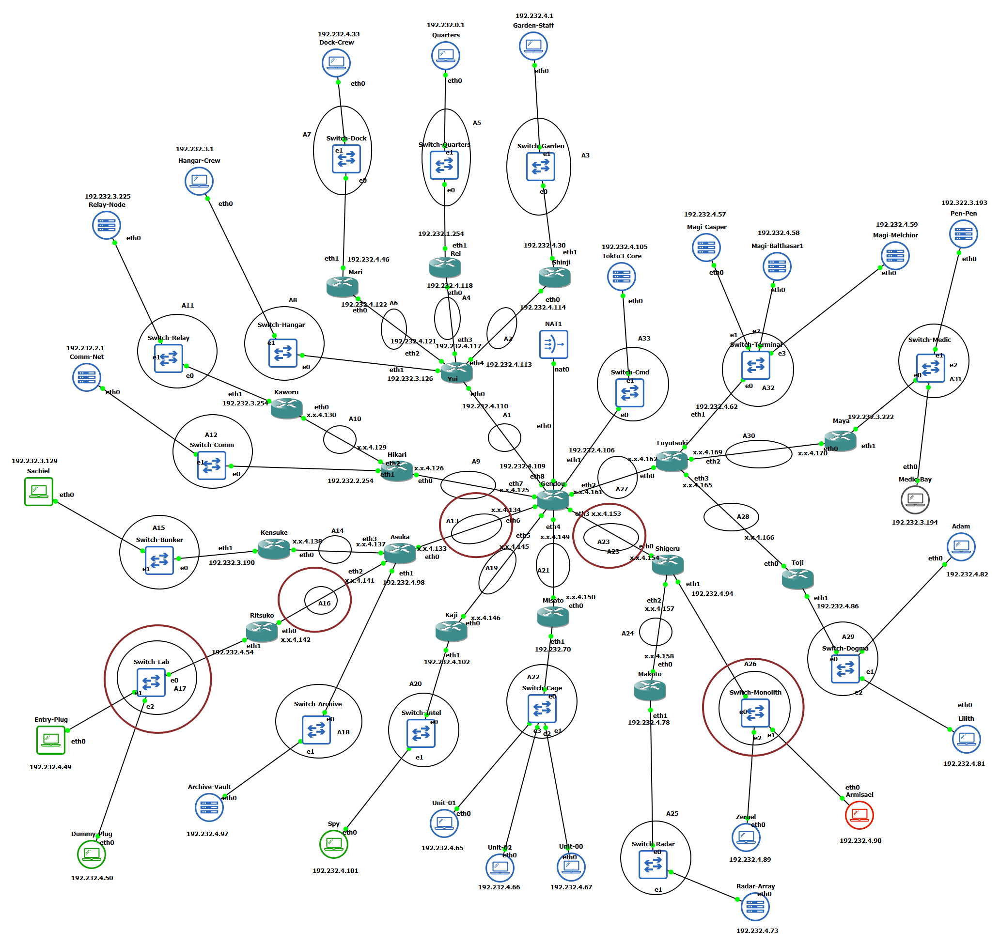
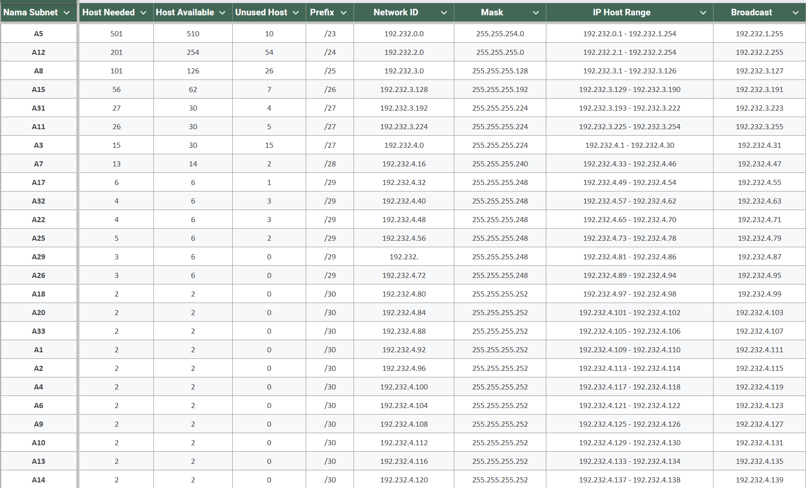
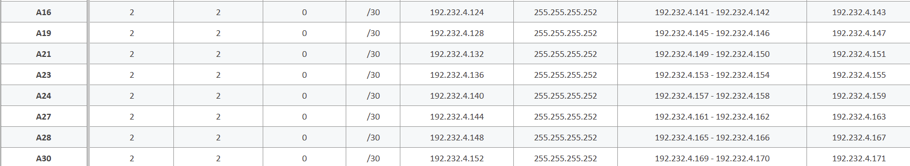

# Soal 1

## Topologi

## Tabel VLSM

Berikut merupakan tabel perhitungannya:
[Tabel Perhitungan VLSM](https://docs.google.com/spreadsheets/d/10po2tn_7QFhXGicL6j-1PMKqqFpVFeZxA0GC1t46BZs/edit?usp=sharing)

