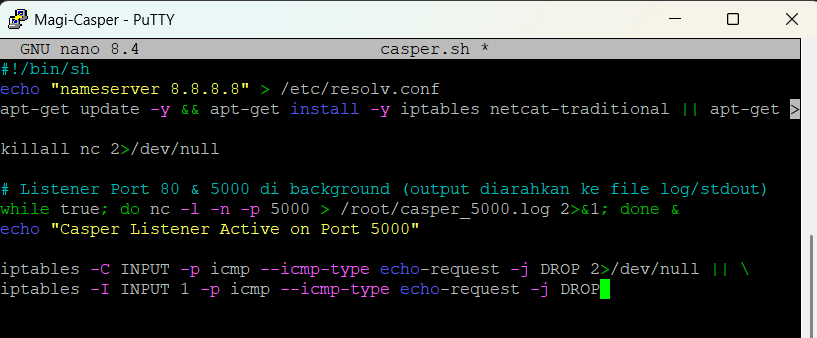
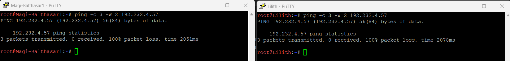
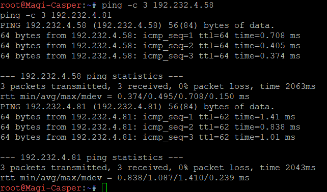

# Soal 11

## Pendahuluan
Pada soal ini, kita kurang lebih membuat node Casper menjadi hantu. Dimana tidak ada perangkat lain yang boleh mem-ping Casper, termasuk yang satu switch. Casper sendiri tetap boleh mem-ping siapa saja. Layanan TCP 5000 Casper tetap hidup. Buktikan ping ke Casper dari Balthasar dan Lilith gagal, sedangkan ping dari Casper ke keduanya berhasil.

## Penyelesaian
Untuk membuat casper tidak bisa di-ping oleh perangkat lain, firewall harus dipasang di Casper sendiri, bukan di router. Balthasar dan Melchior satu switch dengan Casper, jadi paket mereka tidak lewat router mana pun.

Yang diblok hanya echo-request yang masuk. Untuk melakukan ini, tambahkan beberapa line baru pada script yang sudah ada dari soal 7 untuk Casper.

Pada casper.sh, tambahkan:
```
iptables -C INPUT -p icmp --icmp-type echo-request -j DROP 2>/dev/null || \
iptables -I INPUT 1 -p icmp --icmp-type echo-request -j DROP
```



## Pembuktian
Di Balthasar & Lilith:
```
ping -c 3 -W 2 192.232.4.57
```



Di Casper (Ping Balthasar & Lilith):
```
ping -c 3 192.232.4.58
ping -c 3 192.232.4.81
```



Bisa terlihat Balthasar dan Lilith gagal untuk ping Casper dengan 100% packet loss, sedangkan Casper dapat ping Balthasar dan Lilith tanpa masalah.