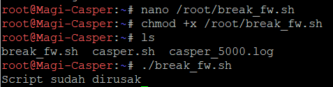
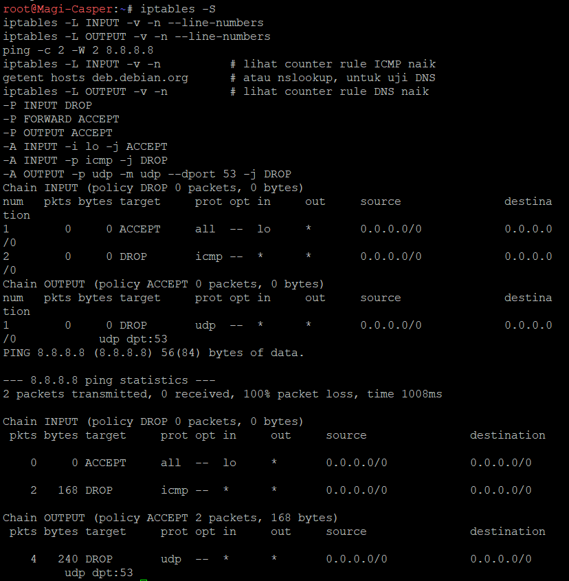
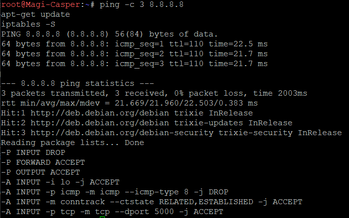
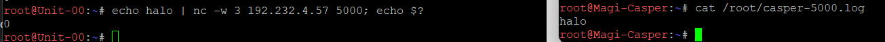

# Soal 12

## Pendahuluan
Jalankan break_fw.sh di Magi-Casper, lalu perbaiki tanpa membatalkan tujuan hardening. Casper tetap menolak semua lalu lintas masuk yang tidak diizinkan, dan policy INPUT tetap DROP. Buktikan nc dari Unit-00 ke Casper port 5000 berhasil dan apt-get update di Casper berhasil.

## Penyelesaian
Pertama kita tambahkan break_fw.sh yang terdapat pada soal di dalam rootnya Casper lalu jalankan.



Setelah rusak, kita sekarang perlu recovery Casper seperti semula. Untuk itu, kita lakukan diagnosis apa saja yang rusak terlebih dahulu:
```
iptables -S
iptables -L INPUT -v -n --line-numbers
iptables -L OUTPUT -v -n --line-numbers
ping -c 2 -W 2 8.8.8.8
iptables -L INPUT -v -n
getent hosts deb.debian.org
iptables -L OUTPUT -v -n
```



Disini kita bisa terlihat apa saja yang rusak, misalnya ping 8.8.8.8 tidak bisa dengan 100% packet loss.

Untuk memperbaikinya dengan tetap menetapkan hardening pada soal-soal sebelumnya, dimana policy INPUT DROP, ping masuk ke Casper tetap ditolak, dan lalu lintas masuk lain yang tidak diizinkan tetap tertolak. Untuk menetapkan hardeningnya dan memperbaiki Casper tersendiri, kita dapat jalankan berikut:
```
iptables -F INPUT
iptables -F OUTPUT
iptables -A INPUT -i lo -j ACCEPT
iptables -A INPUT -p icmp --icmp-type echo-request -j DROP
iptables -A INPUT -m conntrack --ctstate ESTABLISHED,RELATED -j ACCEPT
iptables -A INPUT -p tcp --dport 5000 -j ACCEPT
iptables -P INPUT DROP
```

Disini urutannya penting, rule DROP untuk echo-request berada di depan rule ESTABLISHED, jadi ping masuk dari node lain tetap ditolak. Ini sekaligus mengembalikan syarat nomor 11. Echo-reply untuk ping yang Casper kirim sendiri lolos lewat rule ESTABLISHED.

## Pembuktian
Setelah perbaikan, untuk melakukan verifikasi bahwa sudah normal, kita jalankan berikut sesuai dengan soalnya:
```
ping -c 3 8.8.8.8
apt-get update
iptables -S
```



Disini terlihat ping 8.8.8.8 kembali berfungsi, apt-get update juga berhasil dan kita bisa melihat iptablesnya.

Sebelum kita uji coba nc, kita buatkan log pada casper terlebih dahulu dengan:
```
while true; do nc -l -p 5000 >> /root/casper-5000.log; done &
```

Lalu, pada node Unit-00, kita jalankan:
```
echo halo | nc -w 3 192.232.4.57 5000; echo $?
```



Bisa terlihat shell mengembalikan 0 yang berarti sukses dan jika kita lihat pada log Casper kita bisa melihat echo halo dari Unit-00nya.