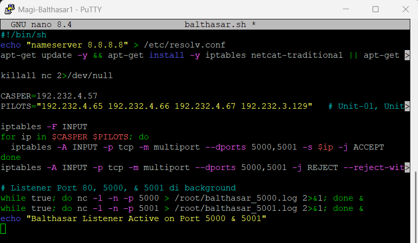
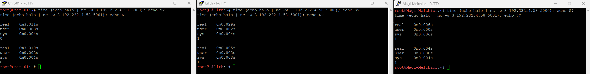
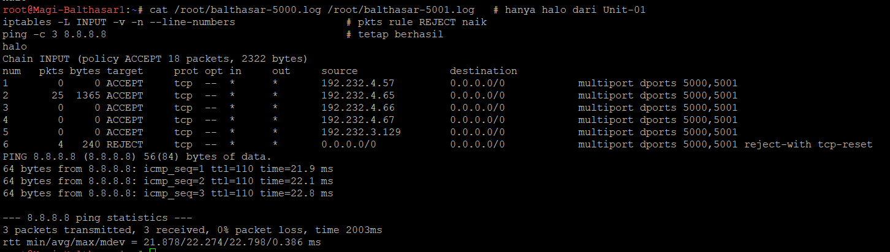

# Soal 13

## Pendahuluan
Pada Balthasar, hanya Casper dan semua Pilot yang boleh menyambung ke TCP 5000 dan 5001. Node lain, termasuk yang satu switch, harus langsung ditolak di kedua port itu, bukan dibiarkan menggantung sampai timeout. Lalu lintas lain tidak boleh terganggu. Balthasar tetap harus bisa ping 8.8.8.8 dan menerima balasannya. Buktikan nc ke port 5000 dan 5001: Unit-01 berhasil, Lilith dan Melchior ditolak seketika.

## Penyelesaian
Mirip seperti Casper, supaya hanya Casper dan semua Pilot bisa ngeping Balthasar, kita pasang firewall pada Balthasarnya sendiri karena Melchior dan Casper satu switch dengannya. Paket mereka tidak lewat router, jadi tidak bisa dicegat di tempat lain.

Maka, untuk membuat firewall ini kita cukup menambahkan beberapa line baru pada balthasar.sh yang berisi dengan firewallnya dan daftar ip Casper dan Pilot-Pilotnya. Kita cukup tambahkan line-line berikut setelah pemasangan iptables dan sebelum listener.
```
CASPER=192.232.4.57
PILOTS="192.232.4.65 192.232.4.66 192.232.4.67 192.232.3.129"   # Unit-01, Unit-02, Unit-00, Sachiel

iptables -F INPUT
for ip in $CASPER $PILOTS; do
  iptables -A INPUT -p tcp -m multiport --dports 5000,5001 -s $ip -j ACCEPT
done
iptables -A INPUT -p tcp -m multiport --dports 5000,5001 -j REJECT --reject-with tcp-reset
```



Lalu kita pasang ulang listener dengan pola loop dengan log yang mirip seperti Casper pada nomor 12.
```
while true; do nc -l -p 5000 >> /root/balthasar-5000.log; done &
while true; do nc -l -p 5001 >> /root/balthasar-5001.log; done &
```

## Pembuktian
Dari Unit-01, Lilith, dan Melchior jalankan:
```
time (echo halo | nc -w 3 192.232.4.58 5000); echo $?
time (echo halo | nc -w 3 192.232.4.58 5001); echo $?
```



Disini terlihat nc yang diterima hanya dari pilot (Unit-01) dengan exit code 1, sedangkan untuk Lilith dan Melchior exit status mereka 1 yang berarti mereka gagal.

Kita juga lakukan pembuktian lanjutan pada Balthasar dengan penetapan bisa ping 8.8.8.8 dan menerima balasannya.
```
cat /root/balthasar-5000.log /root/balthasar-5001.log   # hanya halo dari Unit-01
iptables -L INPUT -v -n --line-numbers                  # pkts rule REJECT naik
ping -c 3 8.8.8.8                                       # tetap berhasil
```



Disini bisa terlihat message echo halo dari Unit-01, iptables yang berisi Balthasar menerima dari Casper dan semua pilot dan menolak lainnya, dan tetap dapat melakukan ping 8.8.8.8.