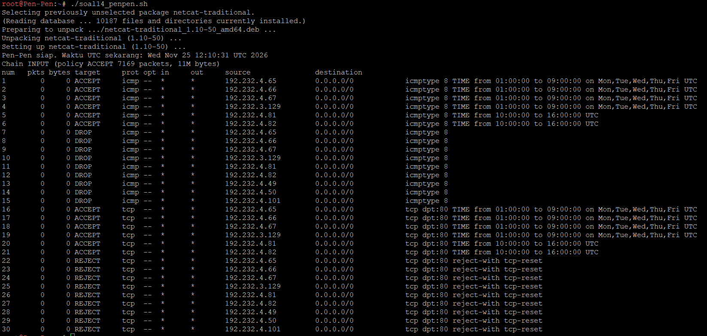
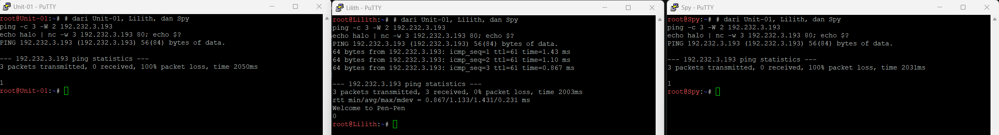

# Soal 14

## Pendahuluan
Pada soal 14 ini, kita harus membuat jadwal kunjungan pen-pen dengan ketentuan yang terdapat pada soalnya. Lalu simpan jadwal sebagai variabel di awal script Pen-Pen, bernama PILOT_START, PILOT_STOP, PILOT_DAYS, STAF_START, dan STAF_STOP. Untuk uji, ubah variabel itu sampai jadwalnya cocok dengan jam sekarang, lalu sampai tidak cocok. Ingat, iptables membaca jam UTC, 7 jam lebih lambat dari WIB. Tunjukkan hasil ping dari Unit-01, Lilith, dan Spy pada kedua kondisi.

## Penyelesaian
Pertama, kita perlu membuat jadwalnya terlebih dahulu dalam bentuk script, dimana kita membuat dan jalankan script `soal14_penpen.sh`



Script sudah terjalan, sekarang masuk ke pembuktian.

## Pembuktian
Untuk melakukan pembuktian, kita jalankan berikut pada Unit-01, Lilith, dan Spy.
```
# dari Unit-01, Lilith, dan Spy
ping -c 3 -W 2 192.232.3.193
echo halo | nc -w 3 192.232.3.193 80; echo $?
```



Pada waktu saya testing sekarang
```
root@Pen-Pen:~# date -u
Wed Nov 25 12:19:21 UTC 2026
```

Hasilnya adalah seperti berikut dimana Unit-01 ditolak, Lilith diterima dan disambut masuk, dan Spy ditolak.

Jadwalnya:
Unit-01 (Pilot)	jendela 01:00-09:00 sudah lewat
Lilith (Staf)	masuk jendela 10:00-16:00
Spy (Dummy)	tidak pernah