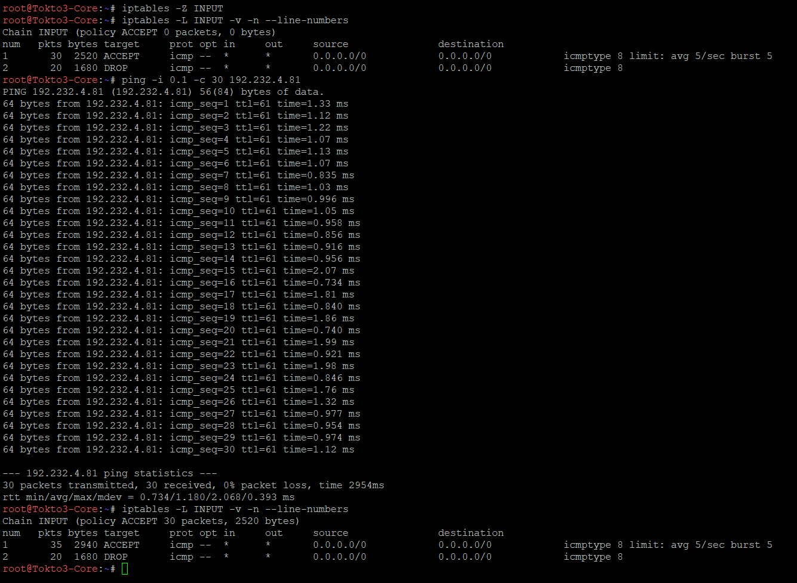
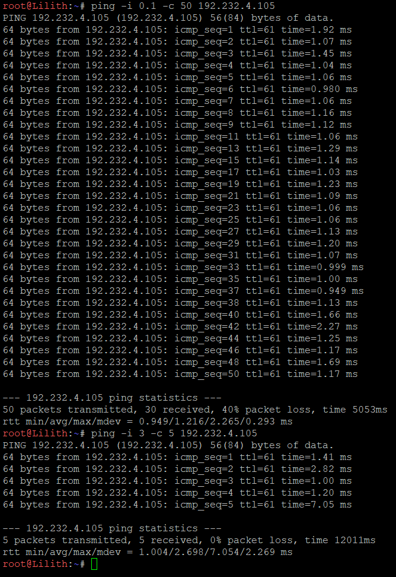

# Soal 15

## Pendahuluan
Batasi Tokyo3-Core agar hanya menjawab maksimal 5 ping per detik, dan buang kelebihannya. Aturan ini tidak boleh mengganggu ping di bawah batas. Aturan ini juga tidak boleh membatasi ping yang dikirim Tokyo3-Core sendiri. Pastikan rule benar-benar mengenai paket yang dituju. Periksa urutan rule dan jenis paketnya. Buktikan ping rapat dari Lilith, misalnya ping -i 0.1 -c50, sebagian hilang, dan tunjukkan counter rule pembuangan naik. Buktikan ping biasa semuanya berhasil, dengan jeda minimal 3 detik di antaranya.

## Penyelesaian
Kita implementasikan peraturan-peraturan dari soalnya di dalam script `soal15_tokyo.sh`.

Setelah scriptnya terjalan, kita lakukan pembuktian.

## Pembuktian
Langkah-langkah pembuktian:
1. Reset counter di Tokyo3-Core sebelum uji:
```
iptables -Z INPUT
```

2. Ping rapat dari Lilith (10 ping per detik, sebagian harus hilang):
```
ping -i 0.1 -c 50 192.232.4.105
```

3. Counter di Tokyo3-Core:
```
iptables -L INPUT -v -n --line-numbers
```

4. Ping biasa semuanya harus berhasil, dengan jeda 3 detik:
```
ping -i 3 -c 5 192.232.4.105
```

5. Ping dari Tokyo3-Core sendiri tidak dibatasi. Di Tokyo3-Core:
```
ping -i 0.1 -c 30 192.232.4.81
```




Disini terlihat hasil dari pembuktiannya, dimana untuk setiap nomor ekspektasi pembuktiannya adalah sebagai berikut:
1. Hanya untuk reset counter
2. Adanya sekitar 40% packet loss yang beneran terjadi yang terlihat dari gambarnya
3. Kolom pkts pada rule DROP naik sekitar 20 dan terlihat dan terbukti
4. Hasilnya 0% packet loss yang terbukti
5. Hasilnya 0% packet loss dan counter DROP tidak bertambah yang terlihat dan terbukti