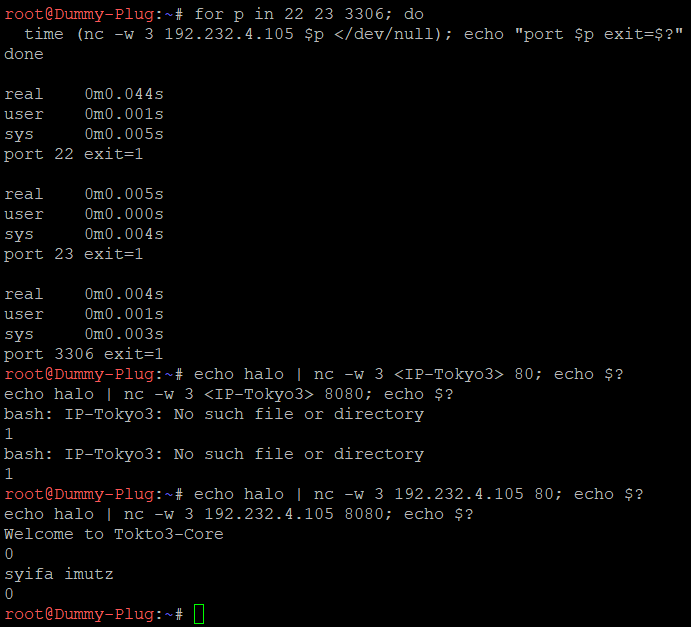
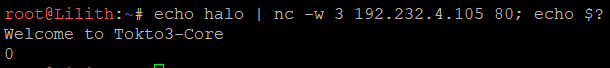
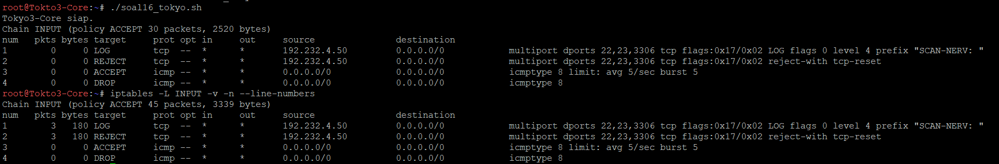

# Soal 16

## Pendahuluan
Ritsuko ingin tahu setiap percobaannya, dan pintunya harus dibanting. Setiap koneksi TCP dari Dummy-Plug ke port 22, 23, dan 3306 di Tokyo3-Core harus dicatat di log dengan prefix huruf besar SCAN-NERV:, lalu ditolak seketika. Port 80 dan 8080 tetap bisa diakses, dan klien lain tidak boleh terganggu. Buktikan nc -w dari Dummy-Plug ke port 22, 23, dan 3306 langsung ditolak, dan ke port 80 dan 8080 berhasil. Tunjukkan counter rule pencatatan, karena log kernel sering tidak terlihat di container.

## Penyelesaian
Kita jalankan script `soal16_tokyo.sh` yang memodifikasi script `soal15_tokyo.sh`. Setelah dijalankan, kita lakukan pembuktian.

## Pembuktian
Dari Dummy-Plug, mengetes port sensitif yang harus ditolak:
```
for p in 22 23 3306; do
  time (nc -w 3 192.232.4.105 $p </dev/null); echo "port $p exit=$?"
done
```

Dari Dummy-Plug lagi, port layanan tetap hidup:
```
echo halo | nc -w 3 192.232.4.105 80; echo $?
echo halo | nc -w 3 192.232.4.105 8080; echo $?
```

Dari Lilith, harusnya tak terganggu dan menghasilkan exit 0:
```
echo halo | nc -w 3 192.232.4.105 80; echo $?
```

Di Tokyo3-Core, tampil counter rule pencatatan dimana pktnya harusnya naik 3:
```
iptables -L INPUT -v -n --line-numbers
```





Disini terlihat bahwa semua hasilnya sudah sesuai dengan ekspektasi dimana pada dummy semuanya menghasilkan exit code 1 yang berarti tidak berhasil, port layanannya tetap hidup dikarenakan exit code 0 dan message masuknya. Di Lilith juga exit code 0 berarti tidak terganggu dan terakhir di Tokyo3-Core terlihat awal saat scriptnya pktsnya 0 lalu naik menjadi 3.