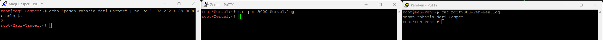
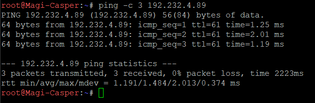
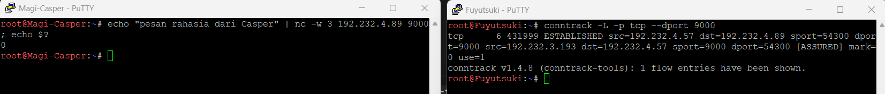

# Soal 17

## Pendahuluan
Di Fuyutsuki, alihkan setiap koneksi TCP dari Magi-Casper ke Zeruel supaya sampai di Pen-Pen. Casper tidak boleh sadar. Balasan yang ia terima harus tetap terlihat datang dari Zeruel. Ping tidak dialihkan. Nyalakan listener port 9000 di Pen-Pen dan Zeruel. Dari Casper, kirim pesan ke IP Zeruel port 9000. Buktikan pesan itu muncul di Pen-Pen, bukan di Zeruel. Tunjukkan juga tabel conntrack di Fuyutsuki.

## Penyelesaian
Untuk soal ini kita jalankan script `soal17_fuyutsuki.sh`.

Setelah menjalankan script, kita buat listener port 9000 di Pen-Pen dan Zeruel dengan menggunakan
```
cat > /root/listener9000.sh <<'EOF'
#!/bin/sh
while true; do
  nc -l -p 9000 >> /root/port9000-$(hostname).log
done
EOF
chmod +x /root/listener9000.sh
nohup /root/listener9000.sh >/dev/null 2>&1 &
```

Setelah membuat log untuk port 9000, kita lanjut ke pembuktian.

## Pembuktian
Di Casper, kita jalankan berikut untuk mengirim pesan ke IP Zeruel dan bukan IP Pen-Pen, hasil yang harusnya terjadi yaitu di log Zeruel tetap kosong tetapi di log Pen-Pen akan berisi "pesan rahasia dari Casper".
```
echo "pesan rahasia dari Casper" | nc -w 3 192.232.4.89 9000; echo $?
```



Disini terlihat dan terbukti kalo log Zeruel kosong tetapi Pen-Pen berisi pesan rahasianya.

Dan untuk membuktikan kalo ping itu tidak diahlikan, di Casper lagi kita jalankan ping ke Zeruel
```
ping -c 3 192.232.4.89
```



Ping masih aman dan terdapat dari Zeruel

Berikut kita coba mendapatkan tabel conntrack di Fuyutsuki dengan menjalankan
```
conntrack -L -p tcp --dport 9000
```

Ini harus dijalankan secara cepat setelah menjalankan pesan rahasia Casper tadi.



Terlihat IP sourcenya dari Casper (192.232.4.57) dan destinasinya Zeruel (192.232.4.89)