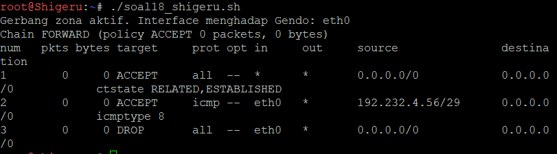
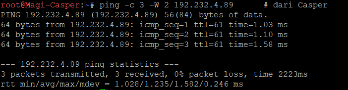
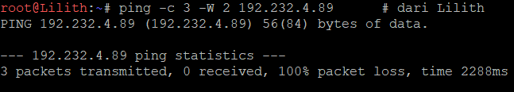
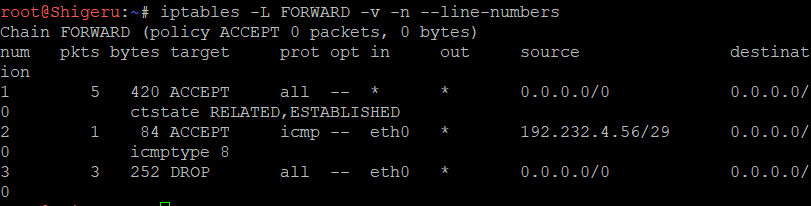

# Soal 18

## Pendahuluan
Pasang aturan di Shigeru. Node di dalam zona boleh memulai koneksi ke mana saja, dan balasannya tetap sampai. Node di luar zona tidak boleh memulai koneksi ke dalam zona. Satu pengecualian: ping dari subnet Terminal boleh masuk. Tolak berdasarkan arah datangnya, yaitu semua yang datang dari sisi Shigeru yang menghadap Gendo. Jangan menulis subnet luar satu per satu, supaya subnet baru langsung ikut terblokir. Buktikan ping Casper ke Zeruel berhasil, sedangkan ping Lilith ke Zeruel gagal.

## Penyelesaian
Kita jalankan script `soal18_shigeru.sh` terlebih dahulu.



Kita bisa melihat status awal setelah menjalankan scriptnya, lalu kita masuk ke pembuktian.

## Pembuktian
Untuk pembuktian, kita melakukan ping antar-node untuk memastikan peraturannya berhasil.

Casper ke Zeruel berhasil:
```
ping -c 3 -W 2 192.232.4.89      # dari Casper
```



Berhasil dengan 0% packet loss, next

Lilith ke Zeruel gagal:
```
ping -c 3 -W 2 192.232.4.89      # dari Lilith
```



Gagal dengan 100% packet loss, terakhir

Kita cek counter di Shigeru:
```
iptables -L FORWARD -v -n --line-numbers
```



Disini kita bisa bandingkan dengan status awalnya, dimana rule nomor 2 (ACCEPT dari Terminal) naik karena ping Casper, dan rule nomor 3 (DROP) naik karena ping Lilith.