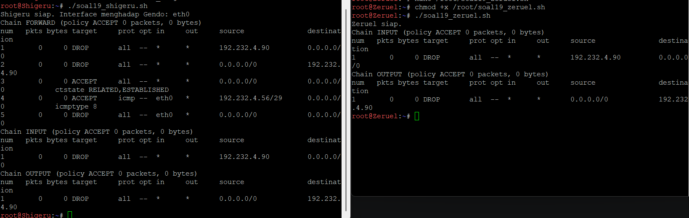
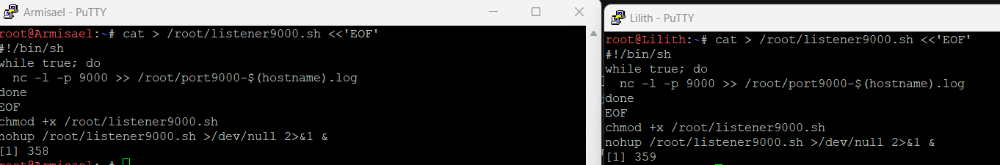
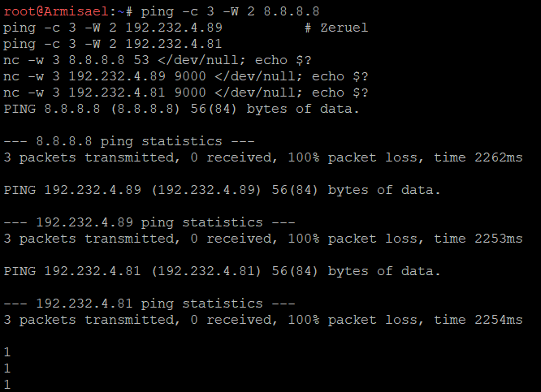
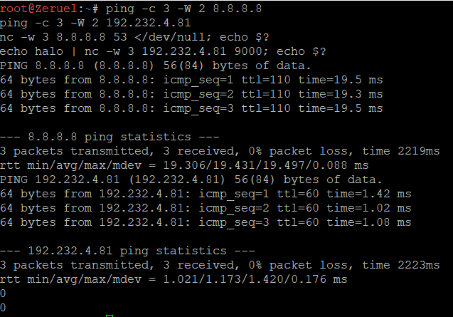

# Soal 19

## Pendahuluan
Armisael tidak boleh lagi bicara dengan siapa pun, tapi Zeruel di sebelahnya tidak boleh ikut terhukum. Blokir semua lalu lintas masuk dan keluar Armisael, termasuk ke gateway dan tetangga satu switch. Isolasi tidak boleh dikerjakan di dalam Armisael, karena pengkhianat tidak bisa dipercaya. Untuk uji nc, nyalakan listener TCP 9000 di Armisael, Zeruel, dan Lilith. Ke Seele pakai TCP 53. Buktikan ping dan nc dari Armisael ke Seele, Zeruel, dan Lilith gagal. Buktikan ping dan nc dari Zeruel ke Seele dan Lilith berhasil.

## Penyelesaian
Kita menjalankan script `soal19_shigeru.sh` untuk override peraturan sebelumnya.

Setelah menjalankan script untuk Shigeru, kita jalankan script untuk Zeruel dengan `soal19_zeruel.sh`



Dan terakhir sebelum pembuktian, kita buat listener untuk uji nc di Armisael, Zeruel, dan Lilith. Berikut dijanlankan di Armisael dan Lilith saja dikarenakan Zerual sudah memiliki listener dari soal 17.
```
cat > /root/listener9000.sh <<'EOF'
#!/bin/sh
while true; do
  nc -l -p 9000 >> /root/port9000-$(hostname).log
done
EOF
chmod +x /root/listener9000.sh
nohup /root/listener9000.sh >/dev/null 2>&1 &
```



Setelah itu, kita siap melakukan pembuktian.

## Pembuktian
Dari Armisael, semuanya harus gagal
```
ping -c 3 -W 2 8.8.8.8
ping -c 3 -W 2 192.232.4.89          # Zeruel
ping -c 3 -W 2 192.232.4.81
nc -w 3 8.8.8.8 53 </dev/null; echo $?
nc -w 3 192.232.4.89 9000 </dev/null; echo $?
nc -w 3 192.232.4.81 9000 </dev/null; echo $?
```



Disini kita bisa melihat untuk semua pingnya gagal dengan 100% packet loss dan untuk ketiga ncnya menghasilkan exit code 1 yang berarti gagal.

Berikut dari Zeruel, ke Seele dan Lilith harus berhasil
```
ping -c 3 -W 2 8.8.8.8
ping -c 3 -W 2 192.232.4.81
nc -w 3 8.8.8.8 53 </dev/null; echo $?
echo halo | nc -w 3 192.232.4.81 9000; echo $?
```



Terbukti semuanya berhasil dengan 0% packet loss untuk pingnya dan menampilkan exit code 0 yang berarti berhasil.