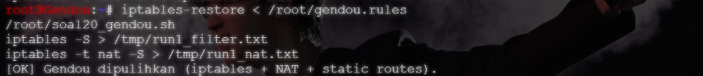
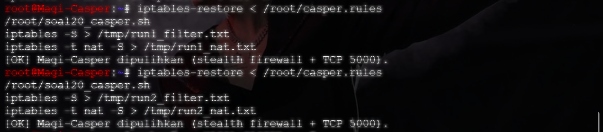
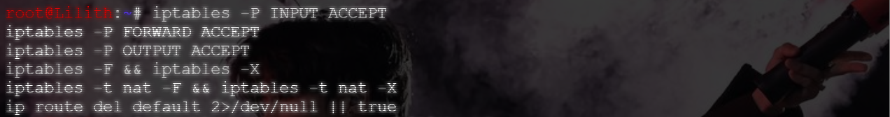
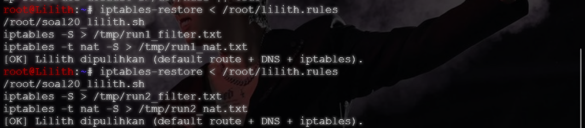
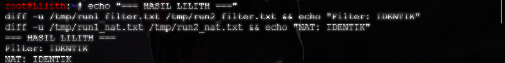
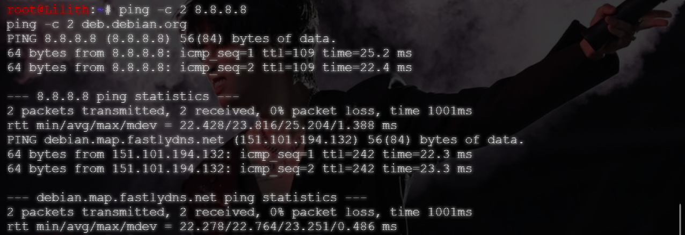

# Soal 20

## Persiapan

Sebelum memulai soal 20, pastikan soal 1-19 sudah running dan siap digunakan. Kemudian pastikan pula script untuk `Gendou`, `Lilith`, dan `Magi-Casper`.

## Uji Coba

### Router `Gendou`dan node `Lilith`

#### Running Simulasi

Pada `Gendou` dan `Lilith`, jalankan simulasi untuk flish total dan peneghapusan rute.

```bash
iptables -P INPUT ACCEPT
iptables -P FORWARD ACCEPT
iptables -P OUTPUT ACCEPT
iptables -F && iptables -X
iptables -t nat -F && iptables -t nat -X
```


Apabila sudah, lakukan pengecekan pada filtering dan NAT nya.

```bash
iptables -S
iptables -t nat -S
```

Output yang diharapkan adalah, tabel filternya hanya berisi `INPUT`, `FORWARD`, dan `OUTPUT`. Sementara untuk NAT hanya berisi `PREROUTING`, `INPUT`, `OUTPUT`, dan `POSTROUTING`.

#### Pemulihan

Selanjutnya, lakukan pemulihan sebanyak 2 kali baik pada `Gendou` maupun `Lilith`.

**Gendou**

Pemulihan pertama `Gendou`.

```bash
iptables-restore < /root/gendou.rules
/root/soal20_gendou.sh
iptables -S > /tmp/run1_filter.txt
iptables -t nat -S > /tmp/run1_nat.txt
```



Pemulihan kedua `Gendou`.

```bash
iptables-restore < /root/gendou.rules
/root/soal20_gendou.sh
iptables -S > /tmp/run2_filter.txt
iptables -t nat -S > /tmp/run2_nat.txt
```


**Casper**

Pemulihan pertama `Casper`.

```bash
iptables-restore < /root/casper.rules
/root/soal20_casper.sh
iptables -S > /tmp/run1_filter.txt
iptables -t nat -S > /tmp/run1_nat.txt
```

Pemulihan kedua `Casper`.

```bash
iptables-restore < /root/casper.rules
/root/soal20_casper.sh
iptables -S > /tmp/run2_filter.txt
iptables -t nat -S > /tmp/run2_nat.txt
```



### Node `Lilith`

#### Simulasi

Sama seperti dua node sebelumnya, hancurkan total terlebih dulu sebelum dipulihkan sebanyak dua kali.

```bash
iptables -P INPUT ACCEPT
iptables -P FORWARD ACCEPT
iptables -P OUTPUT ACCEPT
iptables -F && iptables -X
iptables -t nat -F && iptables -t nat -X
ip route del default 2>/dev/null || true
```



#### Pemulihan

```bash
# Pemulihan 1
iptables-restore < /root/lilith.rules
/root/soal20_lilith.sh
iptables -S > /tmp/run1_filter.txt
iptables -t nat -S > /tmp/run1_nat.txt

# Pemulihan 2
iptables-restore < /root/lilith.rules
/root/soal20_lilith.sh
iptables -S > /tmp/run2_filter.txt
iptables -t nat -S > /tmp/run2_nat.txt
```



### Pengujian

#### Pada `Gendou`

```bash
echo "=== HASIL GENDOU ==="
diff -u /tmp/run1_filter.txt /tmp/run2_filter.txt && echo "Filter: IDENTIK"
diff -u /tmp/run1_nat.txt /tmp/run2_nat.txt && echo "NAT: IDENTIK"
```


#### Pada `Casper`

```bash
echo "=== HASIL CASPER ==="
diff -u /tmp/run1_filter.txt /tmp/run2_filter.txt && echo "Filter: IDENTIK"
diff -u /tmp/run1_nat.txt /tmp/run2_nat.txt && echo "NAT: IDENTIK"
```


Dari `Casper`, harus uji coba pula untung ping ke `Lilith`

```bash
ping -c 2 192.232.4.81
```


#### Pada `Lilith`

```bash
echo "=== HASIL LILITH ==="
diff -u /tmp/run1_filter.txt /tmp/run2_filter.txt && echo "Filter: IDENTIK"
diff -u /tmp/run1_nat.txt /tmp/run2_nat.txt && echo "NAT: IDENTIK"
```



Kemudian, pada `Lilith` harus dilakukan pengujian ping juga.

```bash
ping -c 2 8.8.8.8
ping -c 2 deb.debian.org

ping -c 2 -w 2 192.232.4.57 #Ke CASPER
```



