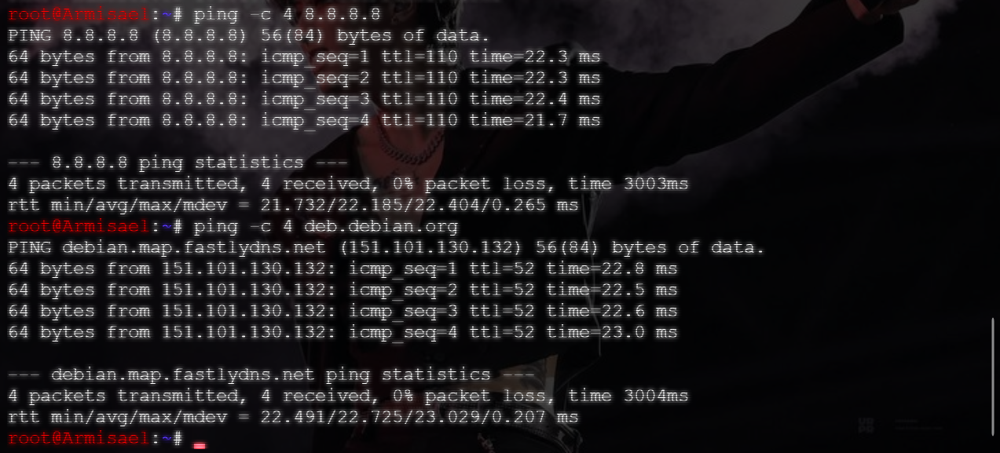
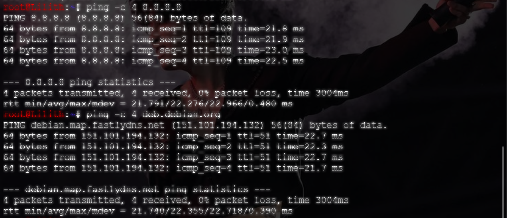
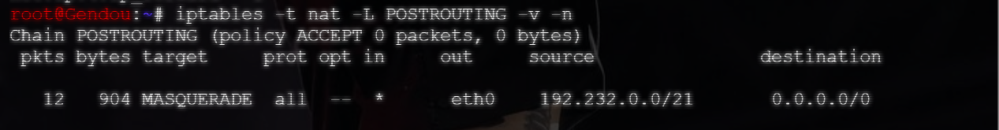

# Soal 4

## Apa yang terjadi?

Pada soal ini diminta untuk seluruh node bisa mengakses internet dengan melalui interface eth0 Gendou-NAT1. Namun jangan gunakan `SNAT` karena IP NAT1 dapat berubah sewaktu-waktu.

Kemudian, pada NAT1 hanya satu subnet saja yang boleh menuju ke internet yang ada di NAT1; yakni `192.232.0.0`.

## Konfigurasi

Pada soal ini, diharuskan masuk ke router dan node agar bisa memasukkan konfigurasi baru.  Jalankan script soal 4 yang ada pada masing-masing node/router, atau masukkan perintah ini ke terminal.

### Pada Gendou

```bash
ip link set dev eth0 up
sysctl -w net.ipv4.ip_forward=1
iptables -t nat -F
iptables -t nat -A POSTROUTING -s 192.232.0.0/21 -o eth0 -j MASQUERADE
```

### Pada Armisael

```bash
echo "nameserver 8.8.8.8" > /etc/resolv.conf
echo "nameserver 1.1.1.1" >> /etc/resolv.conf
```

### Pada Lilith

```bash
echo "nameserver 8.8.8.8" > /etc/resolv.conf
echo "nameserver 1.1.1.1" >> /etc/resolv.conf
```

### Membuat Konfigurasi Permanen

Apabila ingin menjadikan konfigurasi pada `Gendou` menjadi permanen, maka masuk ke `/etc/network/interfaces/` milik Gendou.

```bash
auto eth0
iface eth0 inet dhcp
    up ip link set dev eth0 up
    up sysctl -w net.ipv4.ip_forward=1
    up iptables -t nat -A POSTROUTING -s 192.232.0.0/21 -o eth0 -j MASQUERADE
```

## Pengujian

Untuk menguji hasil konfigurasi, masuk ke masing-masing node. `Armiseal` dan `Lilith`, kemudian jalankan command berikut:

```bash
ping -c 2 8.8.8.8
ping -c 2 deb.debian.org
```





Kemudian lihat counter rule NAT pada Gendou.

```bash
iptables -t nat -L POSTROUTING -v -n
```



## Penjelasan

Pada Gendou, dapat dilihat kolom `pkts` yang menunjukkan seberapa banyak paket yang telah dikirimkan dari node. Karena setiap kali node mengirimkan paket ke domain, node pengirim belum memiliki cache IP `deb.debian.org` atau TTL-nya sudah habis. Maka dari itu sistem akan mengirim 1 paket DNS query menuju DNS Server yakni `8.8.8.8` sebelum paket ICMP echo request dikirim.

Namun balasan dari DNS Response-nya tidak akan menambah counter `POSTROUTING`, ini karena `POSTROUTING` hanya dilakui oleh paket keluar setelah keputusan routing dibuat.
