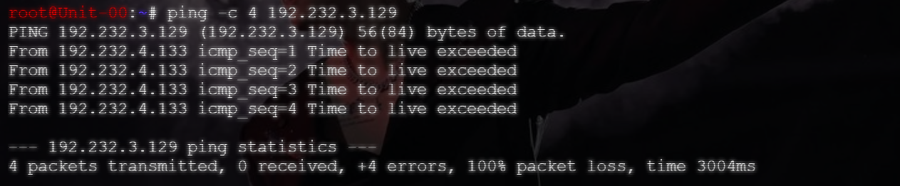
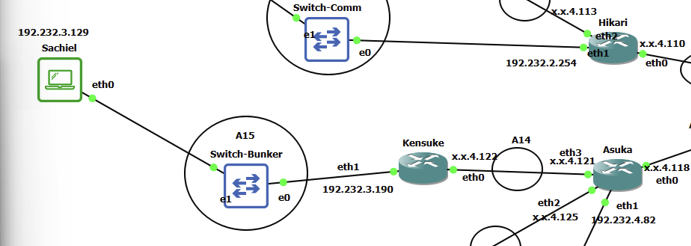
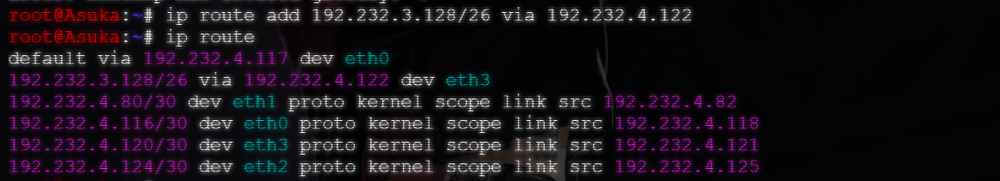

# Soal 6

## Konfigurasi Permanen Node

### Unit-01

```bash
auto lo
iface lo inet loopback
 
auto eth0
iface eth0 inet static
    address 192.232.4.65
    netmask 255.255.255.248
    gateway 192.232.4.70
    up ip link set dev eth0 up
```

### Unit-02

```bash
auto lo
iface lo inet loopback

auto eth0
iface eth0 inet static
    address 192.232.4.66
    netmask 255.255.255.248
    gateway 192.232.4.70
    up ip link set dev eth0 up
```

### Unit-00

```bash
auto lo
iface lo inet loopback

auto eth0
iface eth0 inet static
    address 192.232.4.67
    netmask 255.255.255.248
    gateway 192.232.4.70
    up ip link set dev eth0 up
```

### Garden-Staff

```bash
auto lo
iface lo inet loopback

auto eth0
iface eth0 inet static
    address 192.232.4.1
    netmask 255.255.255.224
    gateway 192.232.4.30
    up ip addr add 192.232.4.1/28 dev eth0
    up ip link set dev eth0 up
    ip route add default via 192.232.4.14
```

### Quarters

```bash
auto lo
iface lo inet loopback

auto eth0
iface eth0 inet static
    address 192.232.0.1
    netmask 255.255.254.0
    gateway 192.232.1.254
    up ip link set dev eth0 up
```

### Dock-Crew

```bash
auto lo
iface lo inet loopback

auto eth0
iface eth0 inet static
    address 192.232.4.33
    netmask 255.255.255.240
    gateway 192.232.4.46
    up ip link set dev eth0 up
```

### Hangar-Crew

```bash
auto lo
iface lo inet loopback

auto eth0
iface eth0 inet static
    address 192.232.3.1
    netmask 255.255.255.128
    gateway 192.232.3.126
    up ip link set dev eth0 up
```

### Relay-Node

```bash
auto lo
iface lo inet loopback

auto eth0
iface eth0 inet static
    address 192.232.3.225
    netmask 255.255.255.224
    gateway 192.232.3.254
    up ip link set dev eth0 up
```

### Comm-Net

```bash
auto lo
iface lo inet loopback

auto eth0
iface eth0 inet static
    address 192.232.2.1
    netmask 255.255.255.0
    gateway 192.232.2.254
    up ip link set dev eth0 up
```

### Sachiel

```bash
auto lo
iface lo inet loopback

auto eth0
iface eth0 inet static
    address 192.232.3.129
    netmask 255.255.255.192
    gateway 192.232.3.190
    up ip link set dev eth0 up
```

### Entry-Plug

```bash
auto lo
iface lo inet loopback

auto eth0
iface eth0 inet static
    address 192.232.4.49
    netmask 255.255.255.248
    gateway 192.232.4.54
    up ip link set dev eth0 up
```

### Dummy-Plug

```bash
auto lo
iface lo inet loopback

auto eth0
iface eth0 inet static
    address 192.232.4.50
    netmask 255.255.255.248
    gateway 192.232.4.54
    up ip link set dev eth0 up
```

### Archieve-Vault

```bash
auto lo
iface lo inet loopback

auto eth0
iface eth0 inet static
    address 192.232.4.97
    netmask 255.255.255.252
    gateway 192.232.4.98
    up ip link set dev eth0 up
```

### Spy

```bash
auto lo
iface lo inet loopback

auto eth0
iface eth0 inet static
    address 192.232.4.101
    netmask 255.255.255.252
    gateway 192.232.4.102
    up ip link set dev eth0 up
```

### Radar-Array

```bash
auto lo
iface lo inet loopback

auto eth0
iface eth0 inet static
    address 192.232.4.73
    netmask 255.255.255.248
    gateway 192.232.4.78
    up ip link set dev eth0 up
```

### Zeruel

```bash
auto lo
iface lo inet loopback

auto eth0
iface eth0 inet static
    address 192.232.4.89
    netmask 255.255.255.248
    gateway 192.232.4.94
    up ip link set dev eth0 up
```

### Armisael

```bash
auto lo
iface lo inet loopback

auto eth0
iface eth0 inet static
    address 192.232.4.90
    netmask 255.255.255.248
    gateway 192.232.4.94
    up ip link set dev eth0 up
```

### Lilith

```bash
auto lo
iface lo inet loopback

auto eth0
iface eth0 inet static
    address 192.232.4.81
    netmask 255.255.255.248
    gateway 192.232.4.86
    up ip link set dev eth0 up
    up ip route add default via 192.232.4.86
```

### Adam

```bash
auto lo
iface lo inet loopback

auto eth0
iface eth0 inet static
    address 192.232.4.82
    netmask 255.255.255.248
    gateway 192.232.4.86
    up ip link set dev eth0 up
```

### Pen-Penc

```bash
auto lo
iface lo inet loopback

auto eth0
iface eth0 inet static
    address 192.232.3.193
    netmask 255.255.255.224
    gateway 192.232.3.222
    ip addr add 192.232.3.193/27 dev eth0
    up ip link set dev eth0 up
    ip route add default via 192.232.3.222
```

### Medic-Bay

```bash
auto lo
iface lo inet loopback

auto eth0
iface eth0 inet static
    address 192.232.3.194
    netmask 255.255.255.224
    gateway 192.232.3.222
    up ip link set dev eth0 up
```

### Magi-Casper

```bash
auto lo
iface lo inet loopback

auto eth0
iface eth0 inet static
    address 192.232.4.57
    netmask 255.255.255.248
    gateway 192.232.4.62
    up ip link set dev eth0 up
```

### Magi Balthasar

```bash
auto lo
iface lo inet loopback

auto eth0
iface eth0 inet static
    address 192.232.4.58
    netmask 255.255.255.248
    gateway 192.232.4.62
    up ip link set dev eth0 up
    up ip route add default via 192.232.4.46
```

### Magi Melchior

```bash
auto lo
iface lo inet loopback

auto eth0
iface eth0 inet static
    address 192.232.4.59
    netmask 255.255.255.248
    gateway 192.232.4.62
    up ip link set dev eth0 up
```

### Tokyo3-Core

```bash
auto lo
iface lo inet loopback

auto eth0
iface eth0 inet static
    address 192.232.4.105
    netmask 255.255.255.252
    gateway 192.232.4.106
    up ip link set dev eth0 up
```

## Pengujian

Untuk soal 6, pengujian dilakukan dengan menjalanakan ping ke gateway dan IP Address node lain.

```bash
ping -c 4 <IP_ADDRESS>
```

## Apabila Error

Apabila terjadi error, atau terjadi hal dibawah ini:



Tambahkan routing pada konfigurasi (melalui GNS3 agar PERMANEN), dan jalankan juga pada terminal apabila hanya butuh untuk sementara.

### Untuk konfigurasi

```bash
up ip route add <IP_Address_Yang_Dituju> via <Jalur_IP_Address_Dari_Routernya>
```

### Untuk terminal

```bash
ip route add <IP_Address_Yang_Dituju> via <Jalur_IP_Address_Dari_Routernya>
```

Contohnya:

Pada gambar dibawah ini, Router `Asuka` tidak memiliki routing ke next-hop, A15.




